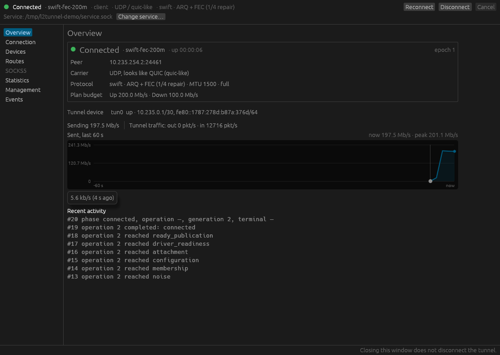
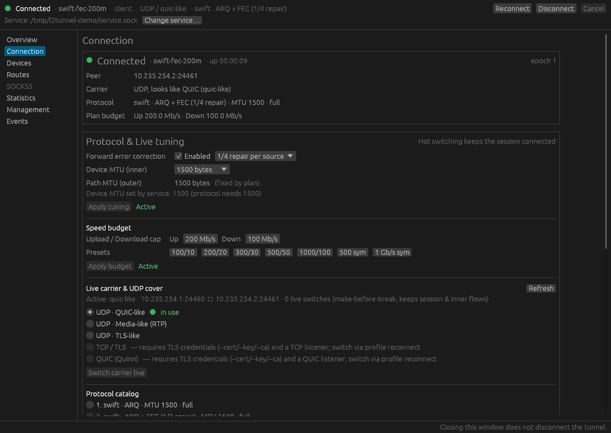
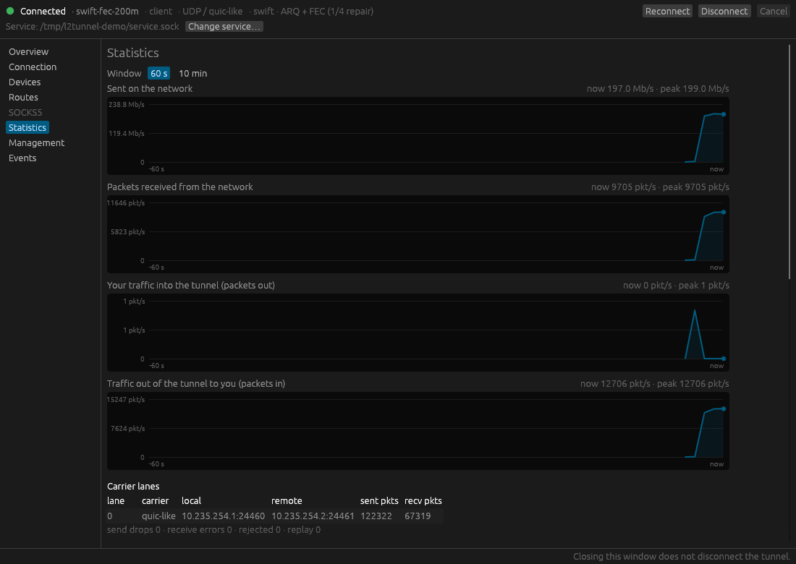
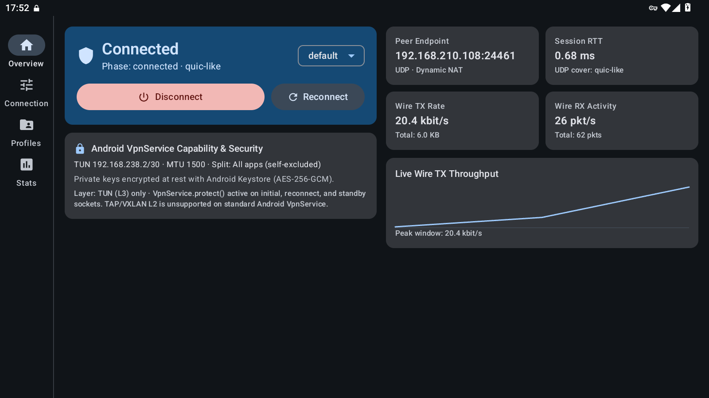
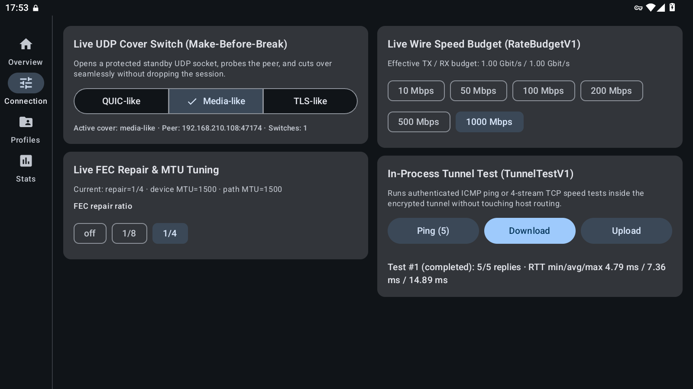
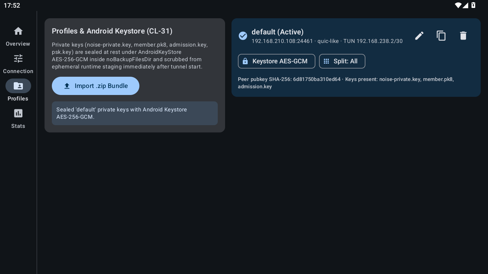
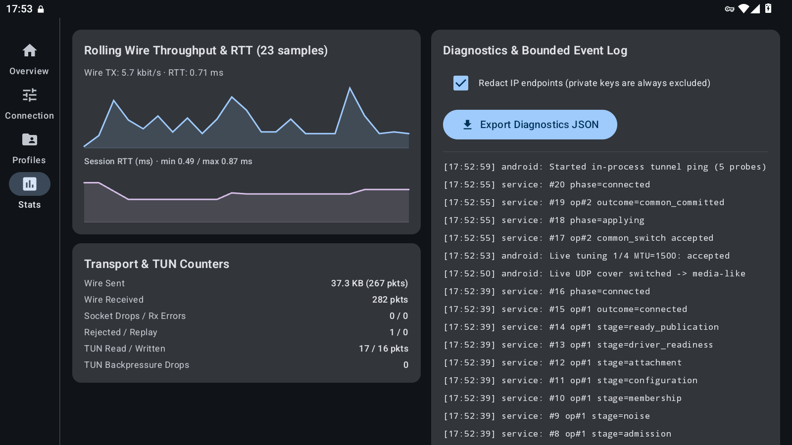

# l2tunnel

A Rust protocol-library workspace for a configurable TAP/TUN tunnel, grounded in
[the Python experiments](simulator/README.md). Platform entry points own
sockets, devices, privileges and process lifecycle; public libraries own
session state, records, MUX, recovery and codecs.

**Current status:** the Common record runtime (`--record-profile common`) is
runnable on Linux over authenticated UDP (`quic-like`, `media-like`, `tls-like`,
`openvpn-like`), raw-packet TCP (`raw-packet`, with optional `--udp-cover tls-like`),
TCP/TLS (`tcp`), and genuine QUIC (`quic`), carrying TAP, TUN, and RFC 7348
VXLAN/VTEP traffic with Swift, Aligned, Packed, Compact, Rolling, Striped,
Research, and TCP-proxy record profiles. A shared local control API v5 backs
`l2tunnelctl`, the `l2tunneld` / `l2tunnel-linux` daemon (with bounded automatic
fresh-authentication recovery enabled by default), and the `egui` desktop GUI
(`l2tunnel-linux-gui` / `l2tunnel-windows-gui`), including live protocol and
FEC/MTU tuning, live speed-budget tuning (`1 Mbit/s..=10 Gbit/s`), live
make-before-break UDP carrier/cover switching, RFC 1928/1929 SOCKS5 over
TCP-proxy, local and remote CSR meters, in-process tunnel speed/ping tests,
and cross-platform `l2tunnel://v1/connect` profile share URIs. The Android
`VpnService` client (`clients/android`, Jetpack Compose + Material You) runs
the shared Rust `l2tunnel-android-service` binary (`arm64-v8a` / `x86_64`) with
`AndroidKeyStore` AES-256-GCM key sealing, per-app split tunneling, and
unprivileged live emulator verification on Android 12 (API 32) and Android 15
(API 35). Windows service/Wintun binaries cross-compile and pass unit/Wine
checks, while native Windows and physical Android device qualification,
multi-core scaling past the single-core CPU ceiling, state-retaining outage
recovery, and full 49-mode parity acceptance remain open. This is not a
complete production VPN. See [current implementation status](docs/implementation-status.md).

## Desktop GUI

The nonprivileged `egui` desktop frontend (`l2tunnel-linux-gui` /
`l2tunnel-windows-gui`) talks to the daemon over local API v5; closing the
window never disconnects an active session.



<details>
<summary>More UI snapshots (Connection live tuning &amp; carrier switch, Statistics &amp; carrier lanes)</summary>

**Connection — live FEC/MTU tuning, speed budget, and make-before-break UDP carrier/cover switching**



**Statistics — live throughput/packet charts and per-lane drop/error counters**



</details>

## Android Client (`VpnService`, Jetpack Compose + Material You)

The Android client ([clients/android](clients/android/README.md)) pairs a
Jetpack Compose Material 3 / Material You adaptive UI (bottom `NavigationBar`
on compact portrait screens; left `NavigationRail` + 2-column dashboards on
landscape/tablet screens) with the cross-compiled Rust `l2tunnel-android-service`
binary over Local API v5 and a UID-verified `SCM_RIGHTS` FD broker (`VpnService.protect()`
on initial, reconnect, and standby carrier-switch sockets). Private keys are
sealed at rest under `AndroidKeyStore` AES-256-GCM inside `noBackupFilesDir`
and scrubbed from ephemeral staging immediately upon tunnel readiness.



<details>
<summary>More Android UI snapshots (Connection live controls, Profiles &amp; Keystore, Stats &amp; Event Log)</summary>

**Connection — make-before-break UDP cover switch, live FEC tuning, speed budget, and in-process `TunnelTestV1`**



**Profiles &amp; Keys — multi-profile store, `AndroidKeyStore` AES-GCM sealing, `.zip` / `l2tunnel://` URI import, and per-app split tunneling**



**Stats &amp; Logs — live rolling TX/RTT area charts, transport/TUN counters, and redacted diagnostics export**



</details>

## Profile Share URIs (`l2tunnel://v1/connect`)

Profiles can be exchanged quickly between `l2tunnelctl`, the Desktop GUI, and
Android (including direct `l2tunnel://` Android deep links) using a versioned,
validated URI format (`<= 16 KiB`, strictly TUN L3):

- **Default (public / safe — zero private keys):** shares server `peer`, UDP
  `cover`, `noise` profile, pinned server `peer_pub`, MTUs, optional `tun`,
  `routes`, `dns`, and `tune_repair`. Importing on Android automatically
  generates fresh local client keys sealed in `AndroidKeyStore` and writes the
  default L3 `common.json` plan.
- **Full provisioning (explicit opt-in only):** `--include-secrets` (CLI) or
  the unchecked **Include secrets** toggle (Desktop GUI / Android) embeds
  `adm`, `key`, `member`, and optional `psk` (`noise=ikpsk2`). Secrets are
  never logged; on CLI use `--uri -` to read from stdin out of shell history.

```sh
# Export a public client-onboarding URI (also derives peer_pub automatically from a serve profile)
l2tunnelctl --control-socket /private/owned-directory/service.sock profile share my-server \
  --tun 10.236.0.2/30 --routes 0.0.0.0/0

# Import a share URI via stdin (keeps any embedded secrets out of shell history)
printf '%s\n' 'l2tunnel://v1/connect?...' | \
  l2tunnelctl --control-socket /private/owned-directory/service.sock profile import my-client --uri -
```

## Speed test & real-kernel highlights

Measured on Linux in strictly isolated owned network namespaces over real kernel
`tun0` (`mtu 1500`, 8 TCP streams across distinct ports with Linux per-netns TCP
autotuning, `tc netem` applied before connect, host sysctls untouched) using the
release `l2tunneld` binary with `swift-fec-udp` (1/4 systematic GF(2^8) repair,
16 channels, `SO_RCVBUFFORCE`/`SO_SNDBUFFORCE` automatic buffer sizing, and
bounded high-BDP session receiver credit):

| Path (`tc netem`, 70 ms RTT / 15% loss each way) | Goodput (`swift-fec-udp`) | Wire efficiency | `l2tunneld` CPU (A / B) | Credit stalls | UDP `RcvbufErrors` |
| --- | ---: | ---: | ---: | ---: | ---: |
| `100 / 10 Mbit/s` | **81.77 Mbit/s** | **81.8%** | 53% / 68% | 812 | **0 / 0** |
| `200 / 20 Mbit/s` | **159.36 Mbit/s** | **79.7%** | 88% / 91% | 10 | **0 / 0** |
| `300 / 30 Mbit/s` | **220.10 Mbit/s** | **73.4%** | 111% / 94% | 28 | **0 / 0** |
| `500 / 50 Mbit/s` | **224.07 Mbit/s** | 44.8% *(single-core CPU ceiling)* | 110% / 83% | **0** | **0 / 0** |
| `1000 / 100 Mbit/s` | **238.30 Mbit/s** | 23.8% *(single-core CPU ceiling)* | 107% / 80% | **0** | **0 / 0** |
| `1000 / 1000 Mbit/s` clean (`0 ms`, `0%` loss) | **222.89 Mbit/s** *(FEC)* / **284.91 Mbit/s** *(ARQ)* | *(single-core CPU ceiling)* | 123–124% / 112–116% | **0** | **0 / 0** |

- **Zero UDP socket drops (`0/0` `RcvbufErrors`)** through 1 Gbit/s without modifying host `net.core.rmem_max`.
- **Scaling boundary:** on this Linux host, one `l2tunneld` owner loop saturates around `~220–238 Mbit/s` (`swift-fec-udp`) and `~285 Mbit/s` (`swift-arq-udp` clean); in-process release simulation (not kernel qualification) reaches `76.0–78.5%` of wire budget up to `1000/100 Mbit/s` under 70 ms RTT / 15% loss.
- **Live carrier switching & VXLAN:** make-before-break UDP cover switching (`quic-like` ↔ `media-like` ↔ `tls-like`) verified with 0% packet loss across live switches; RFC 7348 VXLAN/VTEP with mixed untagged + 802.1Q VLAN filtering (`vlan_filtering 1`), dual isolated VNIs, and kernel-VXLAN interop verified under 15% loss + 25% reorder. See [implementation status](docs/implementation-status.md) and [receiver credit](docs/modules/receiver-credit.md).

## Start here

Start with the [persistent implementation checklist](docs/implementation-checklist.md).
It tracks the 49 mode-catalog entries and the TUN flow control, QoS, internal
L2 management, VXLAN, UDP covers and GUI/CLI work with stable task IDs and evidence.

- [Architecture and protocol decisions](docs/architecture.md)
- [Implementation order, source projects and acceptance gates](docs/implementation-plan.md)
- [Current implementation status](docs/implementation-status.md)
- [TUN active flow control and QoS](docs/flow-control.md)
- [Internal management, VXLAN and UDP covers](docs/overlay-and-carriers.md)
- [CLI/GUI client architecture](docs/client-design.md)
- [Complete Python-to-Rust mode parity](docs/mode-parity.md)
- [Machine-readable mode checklist](config/mode-catalog.toml)
- [Bridge and tc/netem validation plan](docs/testing.md)
- [Coding and verification conventions](CONTRIBUTING.md)

## Build and check

Rust 1.92.0 (pinned in `rust-toolchain.toml`) and Python 3.11+ are required.
Dependencies are pinned in `Cargo.lock` for reproducibility.

```sh
# Full verification gate (requires simulator venv with dev, quic, plots extras)
python3 tools/check.py

# Release binaries (daemon, CLI, Linux client + desktop GUI)
cargo build --release --locked -p l2tunneld -p l2tunnelctl -p l2tunnel-linux --features l2tunnel-linux/gui

# CLI help
cargo run -p l2tunneld -- --help
cargo run -p l2tunnelctl -- --help
```

## Local GUI / real-pair demo

`tools/local_real_pair.py` prepares and runs a real loopback `l2tunneld`
server/client pair (authenticated Common UDP session) for desktop GUI and CLI
testing:

```sh
python3 tools/local_real_pair.py prepare --row swift-arq-udp
python3 tools/local_real_pair.py run --side b --replace
python3 tools/local_real_pair.py run --side a --replace
./target/release/l2tunnel-linux-gui --socket /tmp/l2tunnel-real/control-a.sock
```

## Local control CLI (`l2tunnelctl`, API v5)

Start a daemon or endpoint with `--control-socket /private/owned-directory/service.sock`
(parent directory owned by the effective user, mode `0700`). The grouped CLI
uses the same local API v5 as the desktop GUI:

```sh
l2tunnelctl --control-socket /private/owned-directory/service.sock service status
l2tunnelctl --control-socket /private/owned-directory/service.sock tune show
l2tunnelctl --control-socket /private/owned-directory/service.sock tune set --repair 1/4
l2tunnelctl --control-socket /private/owned-directory/service.sock tune budget --upload 200 --download 100
l2tunnelctl --control-socket /private/owned-directory/service.sock carrier switch --target media-like
l2tunnelctl --control-socket /private/owned-directory/service.sock meters read --remote
l2tunnelctl --control-socket /private/owned-directory/service.sock test speed --streams 4 --seconds 10
l2tunnelctl --control-socket /private/owned-directory/service.sock test ping --count 10
```

Only the authenticated initiator coordinates peer configuration switches. A
local configuration-file edit alone is never an atomic peer switch.

## Isolated Linux namespace harnesses

`tools/netns_lab.py` prints a namespace/bridge/`tc` plan by default and changes
no host network state. Native benchmark plans and isolated campaign runners live
under `tools/` (see [tools/common_native_matrix.md](tools/common_native_matrix.md)
and [docs/testing.md](docs/testing.md)):

```sh
# Export Common benchmark plans (default 100/10, or custom high-BDP budgets)
cargo run --locked -p l2tunnel-client-core --example common_benchmark_plan -- \
  --output-dir /tmp/l2tunnel-plans --budget-mbps 1000/100

# Dry-run topology plan (changes no host state)
python3 tools/netns_lab.py

# Unprivileged Linux TAP self-test (uses user namespaces)
python3 tools/selftest.py
```

Privileged `--apply` namespace runs require root, a fresh `--output` directory,
and a unique `--lab-id`; all link, route, bridge, and qdisc changes remain
inside owned namespaces.

Crates are `publish = false` until the owner chooses licensing and release
policy. No package has been published.
