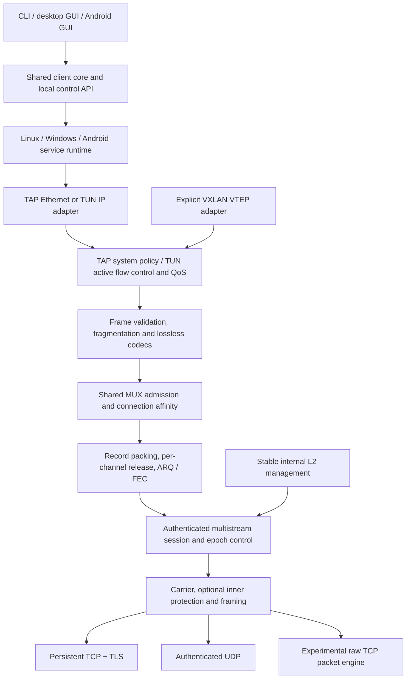

# Protocol architecture

Status: architecture contract under implementation. Runnable Linux TCP/TLS and
protected UDP slices have finite native receipts; broad carrier/mode/platform
coverage remains unfinished. See [current evidence](implementation-status.md).
The referenced experiment chat and current local Python sources informed this
plan; [mode parity](mode-parity.md) records the actual evidence and limitations.
Track implementation in the [checkbox ledger](implementation-checklist.md); detailed
[flow control](flow-control.md), [management/VXLAN/carriers](overlay-and-carriers.md)
and [CLI/GUI clients](client-design.md) extend this architecture.

## Library boundary and layering

The diagram is conceptual: classification precedes codec selection; the shared
arbiter admits records into recovery; encoding may batch across admitted channel
records. Authentication, replay checking and bounded parsing precede decoder
state mutation on receive. Session control sits alongside the pipeline and uses
bounded, rate-limited service; it cannot give user probes a privileged data path.

The public `l2tunnel` facade exports runtime-independent crates. The eventual
engine accepts caller-provided packets, time and configuration events, and emits
bounded actions. Tokio, JNI, Windows handles, Linux capabilities, socket setup,
DNS, config files and logging sinks belong outside that engine. No library
changes routes, opens a device or calls process exit as a side effect.

A carrier lane is an authenticated physical transport connection. A MUX channel
is an ordering/admission domain. An inner flow is a classified user connection.
These counts are independent; the simulator's 16-channel comparison does not
require 16 physical TCP connections. Keep separate fields and metrics for each.

The current runtime still has four audited integration gaps, tracked as blocking
[FIX-01 and FIX-10 through FIX-12](implementation-checklist.md): independent
storage/native-flight/recovery budgets, interchangeable carrier and user recovery,
a negotiated stable session control envelope, and a shared client lifecycle.
Focused base UDP/QUIC/raw delivery integration addresses the first boundary;
the pure common-control codec and managed TCP service address parts of the other
three. The service owns accepted setup deadlines, cancellation and reconnect
cleanup; portable command types are separate from Unix IPC. Other profile
lifecycle paths and negotiated common-control dispatch remain open. These do not complete the
conceptual stack or authorize unchecked combinations. Each composition must
bind its selected policies before I/O and reject unsupported combinations.

## Connection bootstrap, authentication and multistream joining

The portable first implementation uses maintained Rust TLS (rustls, exact version
and provider selected/locked at M1), TLS 1.3, and a persistent TCP socket:

1. Dial the endpoint IP/address independently of the optional TLS server name.
   Complete TLS with server identity checked against configured trust roots or a
   pinned server public key. Absence of SNI must not disable certificate checking.
2. Inside TLS, exchange a bounded version/capability offer and fresh nonces, then
   authenticate tunnel membership. Initial design uses provisioned Ed25519 member
   keys and an allowlist; short-lived join credentials are derived after auth.
   Private keys never appear in logs, command lines or example configs.
3. Sign a domain-separated transcript containing both roles/nonces, server and
   member identity, TLS exporter binding, session ID and complete capability
   offer/selection digest. Server proves acceptance over the same transcript.
   Do not release user frames until both sides finish authentication.
4. Derive separate secrets for lane joining, control authentication and optional
   inner data protection using purpose-specific exporter labels and standard
   HKDF. The public RFC 9266 channel-binding value is not a secret MAC key.
   Disable 0-RTT for authentication, joining, configuration and user data in v1.
5. Each added physical lane completes its own TLS handshake and proves a one-time,
   expiring join token bound to its own exporter, session, role, direction and
   lane ID. This prevents transplanting another connection into the session.
6. Negotiate resource budgets, physical lane count, MUX channels, duplex policy,
   carrier capabilities, packet layer, codec/recovery profile and config digest.
   Unknown mandatory features fail closed; optional fallback is explicitly agreed.
7. Continue using the **same TLS object and TCP socket** for that lane's records.
   No reconnect, new SYN or socket replacement occurs at the auth/data boundary.

Key exchange therefore precedes tunnel-member authentication, while TLS server
verification protects that exchange from interception. TLS sequence numbers,
TCP byte sequence numbers and our tunnel packet numbers are distinct spaces.
TLS record counters are managed by the TLS library. Our counters never reset on a
mode change, and rotate keys/session before exhaustion.

References: [TLS 1.3](https://www.rfc-editor.org/rfc/rfc8446.html),
[TLS exporter channel binding](https://www.rfc-editor.org/rfc/rfc9266.html),
[rustls exporter API](https://docs.rs/rustls/latest/rustls/enum.Connection.html#method.export_keying_material).

## SNI, cover protocols and probing

Default `sni = off`; rustls exposes an explicit `enable_sni` setting. A separate
operator-configurable name can be sent when a cover endpoint requires it. That
name becomes visible without a separately qualified ECH deployment, so it is
mutually exclusive with the strict no-SNI profile. Neither a free-form name nor
no-SNI permits accepting arbitrary unauthenticated certificates. Pinned identity
and the cover name are separate settings; never implement an accept-all verifier.
[rustls client configuration](https://docs.rs/rustls/latest/rustls/client/struct.ClientConfig.html)

There is no defensible guarantee of an unprobeable service or automatic router/QoS
acceptance. Acceptance tests instead check no tunnel-specific unauthenticated
banner, bounded handshake work, generic unauthenticated application failures,
anti-replay and measured behavior under active probes. TLS behavior itself and
packet sizes/timing remain observable. Entropy mimicry and traffic-shape matching
are explicitly outside the requested scope.

Cover profiles are explicit implementations, not magic header prefixes:

| Profile | Meaning and gate |
| --- | --- |
| `tls_stream` | Valid TLS records over the retained TCP connection; not automatically HTTP. |
| `https` | Real HTTPS request/response handling and authenticated streaming, e.g. a framed HTTP/2 body. Match the negotiated ALPN; unauthenticated requests follow a bounded ordinary HTTP handler. Test flow-control/HOL effects. |
| `l2tp` | A genuine L2TP adapter if required. v2 is UDP/PPP; Ethernet pseudowires require the v3 Ethernet profile. Specify encapsulation, session state and packet overhead before enabling. |
| `raw_tcp_experimental` | Custom packet carrier, separately qualified; cannot claim valid HTTPS after leaving TLS record semantics. |

See [L2TPv2](https://www.rfc-editor.org/rfc/rfc2661.html) and
[Ethernet over L2TPv3](https://www.rfc-editor.org/rfc/rfc4719.html).
TLS-stream and HTTPS are M1 work; L2TP and raw TCP are M1 research gates delivered
before their corresponding production mode can be enabled, not implied by M0.

## TCP, raw TCP and UDP capabilities

An explicit `raw_tcp`, `tcp_tls` or `udp_authenticated` selection is authoritative;
unavailability fails unless the operator configured fallback. Automatic preference
is qualified raw TCP, then ordinary TCP/TLS, then UDP when permitted and required.
UDP also requires an explicit `openvpn_like` or `quic_like` cover selection; header
appearance and carrier reliability are separate capabilities. Implementation order starts with TCP/TLS for a
portable correct baseline, then UDP to exercise custom loss recovery, while raw
TCP receives an independent feasibility prototype. `Availability` describes
implemented, permission-checked, path-qualified backends, not OS guesses. All
three availability bits are false in the scaffold; enum presence enables nothing.

| Backend | Preserved behavior | Important constraints |
| --- | --- | --- |
| `tcp_tls` | Original socket, 4-tuple, TCP sequence and TLS state persist after auth. | Reliable ordered delivery, kernel congestion/window/retransmission, outer HOL. Overlay FEC cannot release bytes stuck behind TCP loss. |
| `udp_authenticated` | Shared authenticated session, lane identities and independent protected packets. | Datagram loss/reordering available to custom ARQ/FEC; own pacing and congestion safety required. UDP is an explicit negotiated fallback, never an auth downgrade. |
| `raw_tcp_experimental` | Goal: original 4-tuple and coherent sequence evolution through bootstrap and packet phase. | Needs packet ownership, permission, state tracking and path tests; not provided by a normal TCP socket. |

Ordinary TCP cannot send indefinitely while ignoring ACKs: ACK progress controls
its send window and recovery. On Linux `TCP_QUICKACK=0` is only a nonpersistent
hint to leave quick-ACK mode. Measure it per socket; do not change global TCP
settings or promise a specific delayed-ACK ratio. TCP_NODELAY affects Nagle,
not receiver ACK obligations. Keep inner TCP ACK handling separate from these
outer settings. Windows/Android settings are capability-probed rather than
pretending Linux socket options are portable.
[Linux TCP semantics](https://man7.org/linux/man-pages/man7/tcp.7.html),
[TCP ACK requirements](https://www.rfc-editor.org/rfc/rfc9293.html#section-3.8.6.3)

Raw TCP design gate:

- Prefer one userspace packet owner from SYN through shutdown, including a reliable
  ordered bootstrap stream for TLS. Do not assume a kernel TLS socket can be
  detached and inherited by copying sequence numbers. A kernel-handover variant
  requires a separately reviewed ownership/rollback specification first.
- Explicitly model SYN/FIN consuming sequence space, payload byte accounting,
  modulo-32-bit sequence comparisons, ACK/window policy, retransmitted segments,
  timestamp/PAWS/options, checksums, MTU/PMTUD, RST ownership, NAT idle time and
  reconnect. No host-wide RST suppression is permitted in normal operation.
- TLS authentication may negotiate an independently authenticated datagram packet
  phase on the same tuple. It is then a custom carrier, not ongoing TLS/HTTPS.
  Its inner packet numbers and cryptographic nonces are independent of TCP seq.
- Capture both sides across Linux conntrack/NAT and representative target routers;
  test loss, gaps, delayed ACK, sequence wrap, reordering and long idle. Reusing a
  tuple/sequence alone does not prove middlebox acceptance. If it cannot meet the
  deployment gate, select negotiated TCP compatibility or UDP and expose the reason.

[Linux raw socket requirements](https://man7.org/linux/man-pages/man7/raw.7.html)

UDP has two requested custom cover profiles: `openvpn_like` and `quic_like`.
Implement and test both header/handshake state machines under the common
authenticated session API. Initial development may use TLS-authenticated lane
bootstrap with purpose-specific exporter keys and nonce/expiry-bound tokens; that
stage is explicitly not UDP-only. Standalone UDP bootstrap is also required, with
a maintained authenticated handshake dependency and no mandatory TCP reachability.
Keep header resemblance separate from genuine OpenVPN/QUIC interoperability.
Validation/rebinding, pre-auth work, anti-amplification, replay and PMTU rules apply
to both. Exact requirements and primary sources are in
[carrier profiles](overlay-and-carriers.md#selectable-lower-carriers-and-udp-cover).

Optional encryption means optional **additional inner** confidentiality on TLS;
TLS encryption remains enabled. For UDP/raw, negotiate standard AEAD (initial
candidate ChaCha20-Poly1305) or authenticated cleartext with a standard MAC.
Authenticate all metadata, configuration and payload in either mode. Use separate
keys per direction/lane/purpose and monotonically unique packet numbers, bounded
replay windows, authenticated key rotation and fail-closed downgrade handling.
CRC32 and the simulator's `authentication_bytes` counter are not security.

## Half duplex and full duplex

Default half duplex means one bulk direction per physical carrier, with reverse
ACK/control/feedback always available. A bidirectional Ethernet/IP tunnel uses
paired directional carrier sets, including ordinary reverse user traffic. Role and
direction are agreed during joining; no side is permanently prevented from sending.
Full duplex uses each carrier for both bulk directions, with independent queues,
packet numbers, budgets and recovery state. This is a carrier scheduling policy,
not radio half-duplex timing and not a way to suppress kernel TCP ACKs.

## TUN active flow control and TAP system policy

TAP preserves system TCP and queueing algorithms. TUN adds active tunnel credits,
receiver-pressure feedback and hierarchical per-flow QoS. With few demanding
flows, grow the target credit window more aggressively until delay/memory/receiver
or carrier pressure triggers active backpressure; cap growth and retain congestion
control. Idle connections do not count as demanding flows.

Actual TCP-window ownership is a separate explicit `tun_tcp_proxy` profile with
owned TCP legs. Transparent TUN cannot directly set an application's `cwnd`;
endpoint TCP windows, tunnel credit and carrier congestion allowances are distinct.
Implement both transparent active credit and real TCP proxy capabilities. Existing
connections never silently change TCP ownership during a hot switch. See the
[flow-control specification and FC checklist](flow-control.md) for the algorithm,
credit reservations, QoS, proxy semantics and acceptance matrix.

## Records, MUX, recovery and compression

All supported Python families must reach their individual parity gates. They are
not collapsed into one FEC mode. See the [47-family inventory](mode-parity.md) for
exact symbols, knobs, baselines and research algorithms. Causal research modes
remain tracked; mathematical oracles remain diagnostics.

- Carry complete Ethernet frames for TAP and complete IPv4/IPv6 packets for TUN.
  Never silently fabricate L2 support on Android. Add explicit L3 routing, or a
  separately specified ARP/ND proxy adapter if an L3 peer must join an L2 network.
- Classify IPv4/IPv6 TCP/UDP, VLAN, ARP, fragments and unknown EtherTypes. Unsupported
  header compression falls back to original bytes. Fragment affinity and both-end
  connection creation need deterministic tie-breaking, not Python's conflict error.
- Use one FIFO-per-channel common arbiter in each direction. Preserve the configured
  channel pool for payload, SYN/SYN-ACK, ACK and probes. MUX assignment (CRC32 or
  connection round-robin) is independent of independent-short-record delivery.
- Bound queue bytes **and packet counts**, reassembly lengths/time, context counts,
  generation size, decoder work and old-epoch state. Backpressure reaches device
  reading; drop policies are explicit and instrumented. The M0 MUX bounds payload bytes and
  frame count and normalizes spare Vec capacity; allocator/queue metadata and
  whole-pipeline memory still require measured budgets.
- Implement complete-frame, cross-frame, shared/aligned and packed records; selective
  repetition scopes; native/reliable reverse streams; cumulative/selective/rank
  feedback; ARQ and real full-payload GF(256) recovery. No decoder may consult a
  sender's original payload ledger. Account for repair, retries and padding.
- Header compression is lossless and context-scoped to session/channel/epoch.
  Full-frame fallback preserves unsupported options and checksums. Add optional
  bounded LZ4/Zstd payload blocks after the baseline; skip expanding blocks and
  reset dictionaries across epochs. Never share dictionaries across peers; allow
  sensitive traffic to opt out of compression when ciphertext length is observable.
- TAP and transparent TUN preserve endpoint TCP ACK/window values and behavior.
  Port ACK-generation/coalescing experiments into explicitly owned TCP-proxy or
  benchmark profiles, with supported-option checks and unchanged fallback from
  connection start. Preserve duplicate ACKs, SACK/ECN/control changes; never apply
  simulator congestion-control knobs through transparent packet-header edits.

MTU planning subtracts actual IPv4/IPv6, TCP options or UDP, TLS/HTTP framing,
authentication tag and inner record overhead. The simulator's 1460-byte symbols
with zero authentication bytes cannot be copied unchanged to this wire format.
Keep IP-MTU, Ethernet frame length (including VLAN), source size and application
payload size distinct. Fragment before coding where required and use finite
reassembly bounds. Match data-bearing outer packets to measured PMTU.

The M0 44-byte inner header is deliberately a **draft**, with explicit session,
epoch, packet number and lane fields. It is not Python-wire compatible, contains
no authenticator, and must never be exposed as a standalone protected protocol.
M1 specifies protection, length-prefixed stream assembly and canonical control
records; M2 freezes golden vectors and the first interoperable wire version.

## VXLAN attachment

Support transparent nested VXLAN packets and an explicit VTEP adapter as separate
capabilities. VTEP mode maps authorized VNIs to bridge domains, with bounded FDB
learning/aging, charged BUM replication, split-horizon/loop controls and full nested
MTU accounting. User VXLAN input cannot impersonate internal management traffic.
The VTEP adapter does not turn Android VpnService into TAP; platform combinations
must be advertised and tested separately. See [VXLAN design](overlay-and-carriers.md#vxlan-support).

## Coordinated configuration switching

The session carries a custom internal L2 management protocol for negotiation and
hot switching. Its authenticated record class is distinct from user Ethernet/IP;
TUN sessions can carry it internally without sending L2 frames to the TUN device.
Freeze control decoding, reliable delivery and a bounded service reservation for
the session so data MUX/FEC/compression changes cannot disable their own control
path. User EtherType/MAC matches never confer management authority. The same
carrier carries control, with all bytes charged; ordinary TCP HOL still applies.
See [management protocol](overlay-and-carriers.md#internal-layer-2-management-channel).

A configuration file watcher only proposes a change. A canonical serialized
profile digest, current session, monotonically increasing epoch and a never-reused
proposal-attempt counter identify it. Retrying an aborted proposal uses a fresh
attempt counter, so delayed READY/barrier messages cannot authorize the new try.

1. **PREPARE**: authenticated offer with next epoch, digest, algorithms, budgets
   and lane mappings; receiver validates support and allocates bounded staged state.
   Deterministic coordinator role resolves simultaneous proposals. Retry exact
   duplicates; reject same-epoch/different-digest messages.
2. **READY**: both sides retain old readers and stage new readers. Stop admitting
   new old-epoch frames and record per-direction, per-lane/channel high-water marks.
3. **DRAIN/BARRIER**: old data, retransmits, FEC generations and codec contexts finish;
   peer confirms each high-water mark. A single empty send queue is insufficient.
   Both endpoints continue authenticated feedback so draining cannot deadlock.
4. **COMMIT/COMMIT_ACK**: receiver already understands both epochs before the sender
   releases new data. Lost messages are retried idempotently. A possible remote
   commit forbids unilateral rollback; reconnect/reconcile or fail the session.
5. **RETIRE**: after both directions confirm the old epoch, retain bounded replay
   tombstones/grace state, then discard old codec/MUX/recovery state. Delayed old
   packets must never enter new state or be redelivered.

Fast hot-switch items: repair policy/ratio, supported packing timers, MUX assignment,
channel count, per-channel delivery, QoS weights/targets and compression profile,
subject to barriers. Existing advertised credit cannot be revoked by shrinking a
window target. TCP ownership changes apply only to new flows or a controlled
reconnect; preserve the original mode until each existing flow closes.
Duplex/lane-count changes may require make-before-break lane creation. Changing
peer identity, TLS verification, incompatible wire version, device layer, endpoint
address or carrier ownership is a controlled reconnect, not an in-place local flip.
Limits can shrink only after retained state fits the new budgets.

The M0 `ReloadGuard` tests local readiness/digest/epoch/rollback rules. It does
**not** implement authentication, receiver staging, timed retries, network barriers,
crash recovery or the distributed protocol. M4 supplies those and tests every
message-loss boundary before claiming hot switching works.

## Platform wrappers

| Wrapper | Device/runtime contract |
| --- | --- |
| Linux | TAP or TUN via precreated or privileged setup; optional multiqueue after ordering proof; isolated capability helper where needed. |
| Windows | Wintun for L3; TAP-Windows-compatible driver for L2; service owns driver lifecycle, privileges, routes and shutdown. |
| Android | Kotlin VpnService obtains user authorization, creates IP interface, protects outer sockets from VPN routing, passes owned descriptor to Rust via narrow JNI. No ordinary TAP promise. |

[Linux TUN/TAP](https://docs.kernel.org/networking/tuntap.html),
[Wintun](https://git.zx2c4.com/wintun/about/),
[TAP-Windows](https://github.com/OpenVPN/tap-windows6),
[Android VpnService](https://developer.android.com/reference/android/net/VpnService)

The Android crate is currently an rlib/cdylib staging target with no JNI ABI.
Native platform integration and native-device tests remain M5 gates. Cross-building
portable contracts alone does not validate a platform client.

GUI and CLI use a shared nonprivileged client core and versioned local API. The
service owns credentials, native devices and peer transactions; the GUI does not
run a second protocol engine. See [client source projects and CL checklist](client-design.md).
