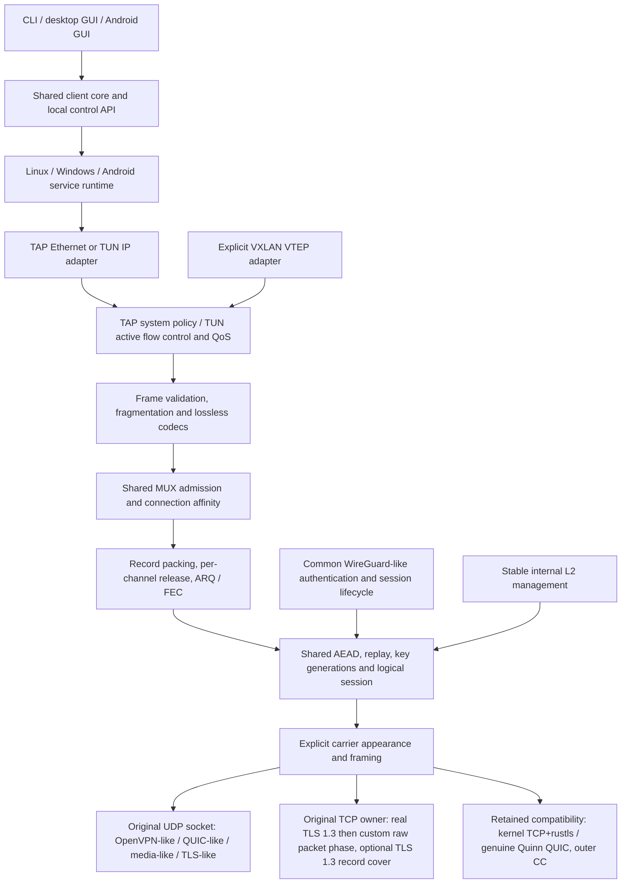

# Protocol architecture

The explicitly selected [KCP-like L2 profile](modules/kcp-like-l2.md) adds a
recovery policy inside Common. It reuses native framing, packing, authentication,
carrier ownership and management; it is not another carrier or a new default.
Its upstream KCP comparison and native performance qualification remain separate.

Status: current-format cutover and verification in progress. Public Rust
protocol libraries remain independent of OS handles, clocks and async runtimes.
Swift and other record algorithms operate inside the selected same-owner carrier;
they are not independent connection defaults. Existing Linux component and
user-space integration receipts have finite scope.

The owner-authorized [compact cutover](modules/compact-wire-cleanup.md) removed
obsolete production entry points and wire encoders (Git retains their history).
**Common per-flow transparent TUN active credit** remains pending (session-level
receiver credit `L2CR` is implemented and live across all Common profiles; see
[receiver-credit.md](modules/receiver-credit.md)); **native Windows/Android
device qualification** and **fresh-DH integration with the Compact owner** also
remain open (Windows Common UDP service + Wintun + GUI and Android
`l2tunnel-android-service` FD broker are implemented and cross-compiled). No
full mode or platform gate closes through deletion.

Current Common Records use a five-byte kind/reader and packet-number prefix.
Data protection adds a 16-byte ChaCha20-Poly1305 tag by default (21 bytes total),
a 32-byte HMAC-SHA256 tag (37 bytes), or an explicitly selected four-byte CCM tag
or unkeyed CRC32C check (9 bytes). Management and recovery feedback use their
independent full-tag domain (21 bytes). Proxy records carrying lifecycle or
credit controls use the strong authenticated-data arm when ordinary data selects
a short check. These are record costs: algorithm union fields, packing, fragments
and the selected carrier remain additional. Raw IPv4/TCP adds 40 bytes, giving
49, 61 or 77 bytes before algorithm fields for the respective data selections
(plus 5 bytes when `--udp-cover tls-like` is enabled); its bootstrap geometry is
separate. Genuine TLS and QUIC retain their mandatory outer protection and
transport behavior.

Selected Block FEC systematic records transmit only their exact original
length-prefixed source extent (the receiver restores omitted zero tails);
Rolling, Research, and sliding repairs serialize the maximum encoded source
extent in their complete support. Common configuration/catalog domains are v5.

The shared CLI/GUI service keeps requested and observed configuration separate:
local API v5 (`l2tunnel-client-core::local`) serves async keyed operations,
bounded events, profiles, host devices/routes, live tuning (`tuning_get` /
`tuning_switch` across Swift/Aligned/Packed), authenticated live speed-budget
tuning (`rate_budget_set`, `ProfileTag::RateBudgetV1`), local and remote CSR
meters (`meters_read` / `meters_catalog`, `ProfileTag::MetersV1`), and
in-process tunnel speed/ping tests (`test_start` / `test_get` / `test_cancel`,
`ProfileTag::TunnelTestV1`), alongside API v4 catalog switching and API v1 proxy
controls. All 49 catalog entries (`config/mode-catalog.toml`: 48 `planned`,
1 `implemented`), full SW-11, native/platform, raw-kernel, resource,
protocol-identification, and measured QoS/performance gates remain in scope. See
[implementation status](implementation-status.md) and
[compact-wire-cleanup.md](modules/compact-wire-cleanup.md#evidence-and-remaining-work).

## Required Python behavior alignment

The [named Python alignment contract](modules/python-behavior-alignment.md)
requires actual recovery ownership, feedback loss/budget, retry timing, codec and
ACK policy parity with each explicitly identified experiment configuration.
The historical per-connection CompactARQ78.7502 Mbit/s reference and the shared
Packed Mux16 C46/C47/C48 candidates are separate compositions. Common integration
is not evidence of either complete algorithm. Replace incorrect selected Rust
behavior; keep historical receipts and explicitly versioned compatibility only.

Priority is L3 TCP, with L2 retained and improved. CompactARQ serial/RTT/ACK-delay/
guarded retries, complete8192/128/every16 with actual short copies and ACK
coalescing, and separately selected per-flow/shared recovery remain required.
Lossy algorithm feedback must not use a reliable side channel. Authenticated
reliable management, common security, selected-carrier continuity and every
existing mode/SW-11/platform/resource/performance requirement remain in scope.
No new default profile or owner wire decision follows from this source audit.

The optional C48 forward repair profile binds a separate forward grammar in the
authenticated Common catalog. Eight consecutive first transmissions can earn one
extra GF(256) equation. Its independent group number leaves local and global
repair serials, reverse feedback, named retry and silent-oldest recovery intact.
Its current runtime uses the original UDP socket's all-traffic accepted IP byte
counter. The gate estimates local serialization from that counter and the
configured pacer. See [wire costs and measured scope](modules/frame-channel-experiment.md#negotiated-eight-source-forward-repair).

Forward selector 10 enables a second, one-MTU near8 account for first-copy
credit that the ordinary account would discard at its cap. A group with more
than eight MTUs queued in the fresh MUX can use that account if recent physical
IP submissions leave capacity. The sender rechecks capacity while computing
the equation and charges the complete IP cost on physical acceptance. The
row uses the same authenticated near8 representation as selector 6. The two
profiles have distinct negotiated configuration digests.

The experimental reverse selector `TargetedExactAckLz4` (9) compresses one
complete compact Packed source when all contained native records are short
IPv4 TCP ACKs. A compressed source starts with a reserved zero record count,
a two-byte original length and a bounded LZ4 block. An ordinary nonzero
record count retains its original representation. The receiver authenticates
and replay-checks the carrier record, restores the exact Packed source, then
admits that source to recovery. Regular FEC equations use the original
bytes. Each systematic copy and named retransmission pays its actual
physical length. The descriptor binds the reverse format independently of
the forward near8 and fixed-anchor selections.

Two forward policies can be evaluated separately. A bounded native reordering
interval acts after complete packet reconstruction at the TUN receiver. A
confirmed-prefix global equation omits only columns below a cumulative source
receipt that the sender has already verified from its peer. Its actual support is
carried in a separately negotiated grammar and stays fixed through retries.
Neither mechanism changes inner TCP's ownership of its congestion window.
The [single-flow evidence](modules/frame-channel-experiment.md#inner-tcp-retransmissions-in-the-single-flow-near8-run)
distinguishes capture replay, endpoint behavior and native workload results.

An optional native-IP body policy assigns each TCP header delta to one full
context on its own channel. The authenticated directional descriptor selects
policy 7. A data body carries tag 11 and a one-byte backward record distance
in the range 1 through 8 before the encoded delta. The receiver can deliver
the IP packet when its own fragments and that exact context are available.
A lost context still needs recovery. The receive epoch owns the history and
the sender retains the existing old-source recovery policy.
[Wire format and single-flow evidence](modules/frame-channel-experiment.md#fixed-anchor-ip-header-compression).

### Mixed data and parity in each packet

The additional point-to-point recovery profile puts an immediately usable
systematic part and parity protecting other positions in every physical
packet. For a group of `n` packets with `m` allowed erasures, `k = n - m`
distinct authenticated packets must suffice to recover all originals.
Existing C48 rolling and Packed block Cauchy remain separate profiles.
Their historical Linux measurements apply to their own formats.

The experimental codec rotates the positions of `k` systematic cells and
`m` Cauchy parity cells in each of `n` stripes. Every physical packet
carries one cell from each stripe and all the direct data for one original.
Thus any `k` packets supply an invertible set of columns for every stripe.
The original length participates in coding. On wire, zero extension after
an original is implicit. The complete parity suffix travels in the same
authenticated packet. An intact source can be handed to the native record
decoder immediately. A fragmented TCP segment still needs its own fragments
and any required header context. The receiver spends reconstruction work
when an earlier source is needed and enough packets have arrived.

The owner selected bounded-time shortening, including splitting a lone
record into two mixed packets. The first source starts the clock. Filling
the group makes it sendable immediately. The experimental shape policy uses
`min(q - 1, ceil(q * m / n))` parity cells for `q >= 2` actual members.
A split group uses two members and reconstructs one logical source. If an
ordinary short group would exceed the path MTU, the sender emits a fitting
contiguous prefix or splits the first source, then rechecks the remaining
sources at the original expiry. The nominal geometry, hold
time and ratio for a short group are engineering parameters under study.
An implementation must charge every physical packet, including splits,
preserve old-gap custody and keep the authenticated management path available.

The current producer exposes first-seal timing, group formation and the
physical charge for fresh members, named retries, quiet retries and outgoing
feedback through the shared service status. The previously selected 500 µs
forward hold and the 1,500 µs experiment are separate authenticated
descriptors. Both use a 500 µs Packed hold and a 500 µs reverse group hold.

The Rust group windows distinguish an admitted logical source, an accepted
physical transmission, a mathematically recoverable group and a committed
original. Only contiguous commits advance the cumulative receipt. A fully
committed later group releases its expanded bytes while retaining its range.
The receiver reserves enough space for a maximum-size frontier group even
when unrelated later groups arrive first.

CompleteV2 tag 10 binds the two directional mixed-packet policies,
including their coding stream, native and packed record limits, source
aperture, MTU and timers. Its functional Common Engine passes actual
Packed sources to a single recovery owner. A source remains outstanding
until every native record depending on it has completed. The authenticated
outer data/feedback class selects the parser, since some legal group
shapes share the first byte of a feedback message. The normal service prices
the physical windows, native codec, dependency and deadline indexes, and
shared small-group decode workspace for each concurrent epoch. Both roles
use the same reserved Engine when the Bank installs a negotiated descriptor.

The group must have its input before parity depending on that input can be
sent. When sufficient packets arrive, prompt recovery saves the loss-feedback
round trip. The send hold, serialization, reordering and local computation
still contribute to latency. See the [packet contract and measurement
limits](modules/frame-channel-experiment.md#mixed-packets-and-local-erasure-recovery).

## Reviewed target and implementation boundary

The physical-path bundle under study divides each native packet across a
configurable number of established carrier paths. Its recovery threshold
is configurable separately. A path can combine its shares from several
native packets in one authenticated datagram. Each path flushes on its own
size limit or the oldest share's deadline. A late path leaves the others
eligible to send. The receiver can deliver any complete native IP packet
to TUN as soon as it has enough distinct coding ordinals for that record.

Feedback batches per-path packet observations and native delivery receipts.
Either direction may carry these receipts in ordinary DATA. A count limit
or deadline triggers standalone feedback when needed. Native source custody
ends on confirmation of delivery to the peer's native interface. Lost
members can be requested by logical record and ordinal and sent on another
authenticated path. Whole-record erasure at the end of a quiet stream
also needs a sender retry. [Implementation and measured scope](modules/frame-channel-experiment.md#independent-physical-paths-for-one-inner-flow).

The sender must also use the selected path's physical ACKs to repair lost
DATA on that path. Positive receipts above a hole provide evidence before
the timer expires. Missing feedback at the paid-send deadline also triggers
repair, including at the end of an idle stream. A receiver forgetting an old
packet number does not acknowledge it. A confirmed native delivery can
cancel the remaining coding work. The experimental reorder threshold,
timer, N/K and target retransmission fraction require measurement.

The experimental sender can share pending member custody across first flights,
named requests and physical retries. Only complete carrier acceptance counts
as payment. A request may take over an unstaged first flight while preserving
its admission deadline; the original lane then skips that same first flight.
Explicit replicas remain separate payments. A bounded scheduler rotates new
members, physical repairs and named/quiet repairs. This optional policy is under
measurement and does not change the normal service's carrier selection.

The subsequent paced-recovery experiment gives all physical paths in one
direction a single byte budget. DATA, native TCP ACK records, authenticated
ACKs and named requests consume the same aggregate capacity; control service
rotates within that budget. Successful socket handoff charges actual IP bytes
plus the modeled Ethernet header. Blocked writes retain their frozen bytes
and cannot consume payment credit. Physical RTT measurements retain a bounded
history of actual packet payments independently of native delivery credit.
These laboratory policies remain explicit selections, with effective rates
and timeout limits observable in the receipt.

The Linux bundle lab offers independent TUN writes, strict group order and
ordered TCP data with a validated pure TCP ACK allowed across a gap. All
three use the same physical data admission and require successful native
handoff for logical confirmation. The shared sender can retain a configured
amount of earned byte credit. Production Common path authentication and
joining remain a separate integration requirement.
[Measured qualifications and open policies](modules/frame-channel-experiment.md#native-delivery-order-and-sender-pacing-in-the-linux-path-bundle).

The 2026-11-13 owner discussion confirmed a fixed point-to-point deployment for
studying tunnel transport and QoS between controlled endpoints. The target uses
one shared internal secure-session protocol across explicitly selected carriers,
including TCP/HTTPS-like. Swift remains a packing/recovery algorithm inside it.
The owner preferred lightweight WireGuard-like authentication and session lifecycle,
while retaining Swift's encrypted and authenticated data. The preceding TLS-based
bootstrap is the integration boundary being replaced; data security is retained.

The [secure-session contract](modules/secure-session.md) separates those confirmed
requirements from unselected dependencies, wire formats, key/provisioning APIs,
timeout values and migration policies. Its SEC-* parent gates remain open. The
following are evidence boundaries, not a declaration that the target is running:

| Area | Current evidence | Target gap |
| --- | --- | --- |
| Pure protocol libraries | Typed bounded engines with injected time/I/O: reserved Swift/Aligned/Packed/Compact/Rolling/Striped/Research owners, Pipeline/MUX, two-slot Bank, session receiver credit (`L2CR`), CSR meters, and in-process `smoltcp` tunnel tests. | Complete nested/external allocator qualification and full selected-runtime acceptance; preserve pure boundaries across carriers. |
| Swift | Common record profile running over UDP (`quic-like`, `media-like`, `tls-like`, `openvpn-like`), `raw-packet`, `tcp`, and `quic`, with SIMD GF(2^8), base-first rotating gap requests, tighter RTT retries, and HoL retry protection. Historical 100/10 Linux TAP receipts and in-process 200–1000 Mb/s 70 ms / 15%-loss benchmarks pass. | Full native high-BDP matrix, complete session recovery lifecycle, and full SW-11 parity. |
| Common record runtime | Sole Tokio loop (`l2tunnel-runtime::secure_udp`) with reserved Bank, `L2CR` receiver credit, Noise M1/M2 live tuning + dynamic device MTU, live speed-budget tuning (`RateBudgetV1`), local/remote CSR meters (`MetersV1`), in-process tunnel tests (`TunnelTestV1`), and local API v5 / desktop GUI. | Complete resource/fault/lifecycle matrices, state-retaining outage recovery, fresh-DH rekey integration, live carrier switching, and high-BDP real-kernel qualification. |
| Genuine QUIC | Maintained Quinn QUIC connection (`--carrier quic`) integrated into Common with finite Linux native receipts. | Distinct from appearance-only `quic-like` UDP; outer congestion control degrades under heavy loss. |
| OpenVPN-like UDP | Standard outer handshake/control layout (`l2tunnel-openvpn-wire`, `l2tunnel-openvpn`) composed with the Common inner session on one UDP socket, with finite Linux TAP/TUN evidence. | Complete fault/resource matrices, unmodified dissector audit, and full ISP qualification. |
| HTTPS / Raw TCP | `l2tunnel-https` (TLS/HTTP2) plus `raw-packet` TCP-to-raw Common carrier with synchronous fast-path send and optional `--udp-cover tls-like` 5-byte TLS 1.3 record cover. | General-path NAT/firewall/middlebox feasibility and cross-platform raw packet ownership. |
| Platforms | Linux TAP/TUN/VXLAN + `l2tunnel-linux-gui` verified locally. Windows Common UDP service + Wintun L3 + named-pipe API v5 + `l2tunnel-windows-gui` cross-compiled and Wine-tested. Android `l2tunnel-android-service` implements abstract-Unix-socket `ScmRights` FD brokering. | Native Windows device/driver qualification, Android JNI/Kotlin VpnService shell, and GUI SOCKS5 remain open. |

The owner relaxed QUIC-like to header appearance without native QUIC data ACK or
congestion semantics, and added minimal audio/video media (`media-like`) and
TLS record (`tls-like`) covers rather than a full WebRTC stack. This does not
relax the OpenVPN wire-handshake gate or the HTTPS-like raw requirement. Full
endpoint interoperability is not required. Standard-header parsing, complete
protocol validity, identification and ISP QoS treatment are separate claims;
initial-packet classification is an unverified hypothesis to measure on the
actual connection. See [implementation status](implementation-status.md) for the
current subsystem summary.

## Library boundary and layering

> **Carrier role distinction (lossy-path performance vs compatibility):**
>
> - **Fast cover carriers (no outer congestion control):** `--carrier quic-like` / `media-like` / `tls-like` (single UDP socket with `l2tunnel-cover` framing) and `--carrier raw-packet` (genuine TCP 3-way + rustls TLS 1.3 handshake via `l2tunnel-raw-io`, then direct raw IPv4/TCP segments paced by the session's own recovery and receiver-credit layer). Selecting `--carrier raw-packet --udp-cover tls-like` additionally wraps every steady-state raw TCP segment in a canonical 5-byte TLS 1.3 Application Data record header (`0x17 0x03 0x03 <len>`) bound into `final_context`.
> - **Retained legacy compatibility carriers (outer congestion control):** `--carrier tcp` (`retained_tls.rs`, kernel TCP + rustls) and `--carrier quic` (`l2tunnel-quic`, genuine Quinn QUIC) remain supported for environments that strictly require kernel TCP or standard QUIC endpoints, but their outer congestion controllers collapse under high packet loss (e.g., ~0.2–0.4 Mbit/s at 15% loss vs ~50–70 Mbit/s on UDP and raw-packet).

The diagram is conceptual: classification precedes codec selection; the shared
arbiter admits records into recovery; encoding may batch across admitted channel
records. Authentication, replay checking and bounded parsing precede decoder
state mutation on receive. Session control sits alongside the pipeline and uses
bounded, rate-limited service; it cannot give user probes a privileged data path.

The public `l2tunnel` facade exports runtime-independent crates. The eventual
engine accepts caller-provided packets, time and configuration events, and emits
bounded actions. Tokio, JNI, Windows handles, Linux capabilities, socket setup,
DNS, config files and logging sinks belong outside that engine. No library
changes routes, opens a device or calls process exit as a side effect.

A carrier lane is an authenticated physical transport connection. A MUX channel
is an ordering/admission domain. An inner flow is a classified user connection.
These counts are independent; the simulator's 16-channel comparison does not
require 16 physical TCP connections. Keep separate fields and metrics for each.

The current runtime still has four audited integration gaps, tracked as blocking
[FIX-01 and FIX-10 through FIX-12](implementation-checklist.md): independent
storage/native-flight/recovery budgets, interchangeable carrier and user recovery,
a negotiated stable session control envelope, and a shared client lifecycle.
Focused base UDP/QUIC/raw delivery integration addresses the first boundary;
the pure common-control codec and managed TCP service address parts of the other
three. The service owns accepted setup deadlines, cancellation and reconnect
cleanup; portable command types are separate from Unix IPC. Other profile
lifecycle paths and negotiated common-control dispatch remain open. These do not complete the
conceptual stack or authorize unchecked combinations. Each composition must
bind its selected policies before I/O and reject unsupported combinations.
The newer common-session correction is tracked by FIX-13 and SEC-*; a service
wrapper around Swift's current dual-flow design does not satisfy it. The CLI and
GUI share one service API and report requested/effective carrier, appearance,
protection, data profile, recovery state and unsupported capability reasons.

## Connection bootstrap, authentication and multistream joining

The existing retained-TLS compatibility implementation uses maintained rustls,
TLS 1.3 and a persistent TCP socket. Its contract and historical tests remain:

1. Dial the endpoint IP/address independently of the optional TLS server name.
   Complete TLS with server identity checked against configured trust roots or a
   pinned server public key. Absence of SNI must not disable certificate checking.
2. Inside TLS, exchange a bounded version/capability offer and fresh nonces, then
   authenticate tunnel membership. Initial design uses provisioned Ed25519 member
   keys and an allowlist; short-lived join credentials are derived after auth.
   Private keys never appear in logs, command lines or example configs.
3. Sign a domain-separated transcript containing both roles/nonces, server and
   member identity, TLS exporter binding, session ID and complete capability
   offer/selection digest. Server proves acceptance over the same transcript.
   Do not release user frames until both sides finish authentication.
4. Derive separate secrets for lane joining, control authentication and optional
   inner data protection using purpose-specific exporter labels and standard
   HKDF. The public RFC 9266 channel-binding value is not a secret MAC key.
   Disable 0-RTT for authentication, joining, configuration and user data in v1.
5. Each added physical lane completes its own TLS handshake and proves a one-time,
   expiring join token bound to its own exporter, session, role, direction and
   lane ID. This prevents transplanting another connection into the session.
6. Negotiate resource budgets, physical lane count, MUX channels, duplex policy,
   carrier capabilities, packet layer, codec/recovery profile and config digest.
   Unknown mandatory features fail closed; optional fallback is explicitly agreed.
7. In the retained-TLS profile, continue using the **same TLS object and TCP socket** for that lane's records.
   No reconnect, new SYN or socket replacement occurs at the auth/data boundary.

Key exchange therefore precedes tunnel-member authentication, while TLS server
verification protects that exchange from interception. TLS sequence numbers,
TCP byte sequence numbers and our tunnel packet numbers are distinct spaces.
TLS record counters are managed by the TLS library. Our counters never reset on a
mode change, and rotate keys/session before exhaustion. Public APIs support
root/name verification with SNI disabled or configurable independent SNI
(`ClientSni::Named`, `--sni`); a public pin verifier remains an open gate.

The new target replaces the separate TCP/TLS-bootstrap dependency with one shared
message-oriented WireGuard-like authentication/session layer. Reuse maintained
key-exchange and cryptographic implementations. Specify loss/reorder/duplicate
handling, cookies, original handshake deadlines, anti-amplification, key confirmation,
replay protection, expiry and rehandshake before releasing data. Bare Noise or
copying two packet formats does not implement that complete lifecycle.

Both endpoints must authenticate the selected carrier/appearance, packet layer,
roles, fresh session identity, full configuration digest and capability/resource
selection. Retain purpose/direction/lane-separated secret derivation and fresh
packet-number domains without extracting private library state. Existing member
credentials and lane requirements remain until a reviewed binding is specified;
the point-to-point deployment does not require account or device-enrollment work.

Use the selected carrier's **same connection or UDP socket and five-tuple** through
authentication, data and ongoing control. A TCP authentication flow followed by a
different UDP data flow cannot satisfy this target. For HTTPS-like, outer real
TCP/TLS is still required and the authenticated transition must retain the original
TCP owner, ports and coherent sequence space. That outer handshake is distinct
from the common inner peer-authentication protocol; their exact binding remains
a SEC-03/SEC-09 acceptance gate. Independent UDP traffic has no required TCP side
channel. Additional lanes still need authenticated joining and domain separation.

References: [TLS 1.3](https://www.rfc-editor.org/rfc/rfc8446.html),
[TLS exporter channel binding](https://www.rfc-editor.org/rfc/rfc9266.html),
[rustls exporter API](https://docs.rs/rustls/latest/rustls/enum.Connection.html#method.export_keying_material).

## SNI, cover protocols and probing

The retained-TLS implementation has `sni = off`; rustls exposes an explicit
`enable_sni` setting. The target retains an operator-configurable SNI policy. A separate
operator-configurable name can be sent when a cover endpoint requires it. That
name becomes visible without a separately qualified ECH deployment, so it is
mutually exclusive with the strict no-SNI profile. Neither a free-form name nor
no-SNI permits accepting arbitrary unauthenticated certificates. Pinned identity
and the cover name are separate settings; never implement an accept-all verifier.
[rustls client configuration](https://docs.rs/rustls/latest/rustls/client/struct.ClientConfig.html)

There is no defensible guarantee of an unprobeable service or automatic router/QoS
acceptance. Acceptance tests instead check no tunnel-specific unauthenticated
banner, bounded handshake work, generic unauthenticated application failures,
anti-replay and measured behavior under active probes. TLS behavior itself and
packet sizes/timing remain observable. Packet-entropy and traffic-shape matching
are explicitly outside the requested scope.

Cover profiles have explicit protocol and compatibility requirements:

| Profile | Meaning and gate |
| --- | --- |
| `openvpn_like` | Standard OpenVPN outer control-handshake and outer layout over one UDP socket composed with the common inner session; unmodified dissector audit remains open and full endpoint interoperability is not required. |
| `quic_like` | Owner-selected header appearance (`l2tunnel-cover`) over the original UDP socket. Native QUIC data ACK, congestion and full protected-frame validity are not required. Genuine QUIC (`--carrier quic`) remains a distinct compatibility capability. |
| `media_like` | Minimal 14-byte audio/video RTP-like appearance (`l2tunnel-cover`) on the original UDP socket; no full ICE/DTLS-SRTP/SCTP/browser stack or codec interoperability is required. |
| `tls_like` | 17-byte TLS 1.3 record framing over UDP (`Appearance::TlsLike`) or 5-byte TLS 1.3 Application Data framing on `raw-packet --udp-cover tls-like`. |
| `https_like` | Real TCP/TLS handshake, then authenticated custom TCP-shaped packets (`--carrier raw-packet`) on the same ports and sequence space, with user-data recovery outside ordinary TCP ACK-driven transport. This ceases to be genuine TLS/HTTPS after transition. |
| `tls_stream` | Retained compatibility profile (`--carrier tcp`) with valid TLS records over the original TCP connection; not automatically HTTP. |
| HTTPS streaming | Separate compatibility work (`l2tunnel-https`) with actual HTTP request/response, matching ALPN and authenticated streaming (HTTP/2 DATA); does not replace `https_like`. |
| `l2tp` | A genuine L2TP adapter if required (planned). v2 is UDP/PPP; Ethernet pseudowires require the v3 Ethernet profile. |
| `raw_tcp_experimental` | Custom packet carrier, separately qualified; cannot claim valid HTTPS after leaving TLS record semantics. |

See [L2TPv2](https://www.rfc-editor.org/rfc/rfc2661.html) and
[Ethernet over L2TPv3](https://www.rfc-editor.org/rfc/rfc4719.html).
These names describe target contracts, not new accepted CLI values. Existing
library/CLI selectors and their actual limits remain visible until integration.
L2TP and broader raw deployment remain independent qualification gates.

## TCP, raw TCP and UDP capabilities

The operator explicitly selects the carrier/appearance. Unavailability fails
unless a fallback was explicitly configured; an automatic raw/TCP/UDP preference
must not override that choice. Carrier delivery semantics, outer appearance,
Swift/recovery, native layer and duplex scheduling remain separate capabilities.
`Availability` must describe implemented, permission-checked, path-qualified
backends, not OS guesses or enum presence. Current compatibility paths retain
their existing identities and evidence; no new selector is enabled by this design.

| Backend | Preserved behavior | Important constraints |
| --- | --- | --- |
| `tcp_tls` | Original socket, 4-tuple, TCP sequence and TLS state persist after auth. | Reliable ordered delivery, kernel congestion/window/retransmission, outer HOL. Overlay FEC cannot release bytes stuck behind TCP loss. |
| `udp_authenticated` | Common Noise/member authenticated session on the original UDP socket, with independent protected packets and lane identities. | Datagram loss/reordering available to custom ARQ/FEC; own pacing, receiver credit (`L2CR`), and congestion safety required. UDP is explicitly selected and never an auth downgrade. |
| `raw_tcp_experimental` | Goal: original 4-tuple and coherent sequence evolution through bootstrap and packet phase. | Needs packet ownership, permission, state tracking and path tests; not provided by a normal TCP socket. |

Ordinary TCP cannot send indefinitely while ignoring ACKs: ACK progress controls
its send window and recovery. On Linux `TCP_QUICKACK=0` is only a nonpersistent
hint to leave quick-ACK mode. Measure it per socket; do not change global TCP
settings or promise a specific delayed-ACK ratio. TCP_NODELAY affects Nagle,
not receiver ACK obligations. Keep inner TCP ACK handling separate from these
outer settings. Windows/Android settings are capability-probed rather than
pretending Linux socket options are portable.
[Linux TCP semantics](https://man7.org/linux/man-pages/man7/tcp.7.html),
[TCP ACK requirements](https://www.rfc-editor.org/rfc/rfc9293.html#section-3.8.6.3)

Raw TCP design gate:

- Prefer one userspace packet owner from SYN through shutdown, including a reliable
  ordered bootstrap stream for TLS. Do not assume a kernel TLS socket can be
  detached and inherited by copying sequence numbers. A kernel-handover variant
  requires a separately reviewed ownership/rollback specification first.
- Explicitly model SYN/FIN consuming sequence space, payload byte accounting,
  modulo-32-bit sequence comparisons, ACK/window policy, retransmitted segments,
  timestamp/PAWS/options, checksums, MTU/PMTUD, RST ownership, NAT idle time and
  reconnect. No host-wide RST suppression is permitted in normal operation.
- TLS authentication may negotiate an independently authenticated datagram packet
  phase on the same tuple. It is then a custom carrier, not ongoing TLS/HTTPS.
  Its inner packet numbers and cryptographic nonces are independent of TCP seq.
  The common inner security protocol must be bound to that authenticated ownership
  transition; replacing bootstrap does not permit skipping the outer TLS gate.
- Capture both sides across Linux conntrack/NAT and representative target routers;
  test loss, gaps, delayed ACK, sequence wrap, reordering and long idle. Reusing a
  tuple/sequence alone does not prove middlebox acceptance. If it cannot meet the
  deployment gate, fail visibly or use only an explicitly authorized fallback and
  expose the reason. An irreversible packet-phase seal cannot roll back to TLS.

On Linux, opening a raw socket alone does not stop the kernel TCP handler from
sending RST or ACK traffic. The current raw opener requires CAP_NET_RAW, rejects
the initial namespace and validates an existing exact-tuple marked RST policy.
The caller/lab must separately prove namespace ownership; the opener's namespace
check is not an ownership oracle. It does not install firewall rules or transfer
a live kernel TCP socket. Production
privilege/firewall ownership, rollback/cleanup and crash recovery remain separate
design gates. Windows needs a separately reviewed packet/driver boundary; Android
VpnService alone does not establish raw-underlay ownership. Neither platform has
this runtime implemented. Do not generalize four clean Linux integrity-mode
receipts into NAT, middlebox, impairment or cross-platform qualification.

[Linux raw socket requirements](https://man7.org/linux/man-pages/man7/raw.7.html)

UDP appearances are `openvpn_like`, `quic_like`, `tls_like`, and minimal
`media_like`, running above one common Noise/member authenticated session
without requiring ordinary TCP reachability. Actual OpenVPN handshake/layout,
header-only QUIC/TLS appearance and minimal media appearance have different
parsing gates; none implies endpoint interoperability or identification
resistance. Pre-auth work, anti-amplification, replay and PMTU bounds apply to
all; authenticated rebinding is an unresolved policy, not permission to change
the normal-flow continuity requirement. See
[carrier profiles](overlay-and-carriers.md#selectable-carriers-and-cover-profiles).

Optional encryption means optional **additional inner** confidentiality on TLS;
TLS encryption remains enabled. For UDP/raw, negotiate standard AEAD (initial
candidate ChaCha20-Poly1305) or authenticated cleartext with a standard MAC.
Authenticate all metadata, configuration and payload in either mode. Use separate
keys per direction/lane/purpose and monotonically unique packet numbers, bounded
replay windows, authenticated key rotation and fail-closed downgrade handling.
CRC32 and the simulator's `authentication_bytes` counter are not security.
The owner clarified that the shared-session migration must preserve Swift's
current ChaCha20-Poly1305 encrypted/authenticated data; the requested change is
the preceding authentication/carrier layer. The generic authenticated-cleartext
requirement above remains tracked, not inferred away. A WireGuard-like extension
for it needs a reviewed supported secret/protection interface. No private-state
export, altered cryptographic primitive or unmodified-WireGuard claim is permitted.

The subsequent explicitly selected compact-wire design adds AES-CCM with a
four-byte data tag or ChaCha20 with CRC32C. This is an explicit data-profile
exception to the legacy all-payload authentication policy above, not a new
default or an authentication claim for CRC. Management and retiring feedback
keep separate full-tag protection. The [compact contract](modules/compact-wire-cleanup.md)
records the approved options, their actual guarantees, negotiated limits and
remaining migration scope; existing authenticated formats remain selectable.

## Half duplex and full duplex

Default half duplex means one bulk direction per physical carrier, with reverse
ACK/control/feedback always available. A bidirectional Ethernet/IP tunnel uses
paired directional carrier sets, including ordinary reverse user traffic. Role and
direction are agreed during joining; no side is permanently prevented from sending.
Full duplex uses each carrier for both bulk directions, with independent queues,
packet numbers, budgets and recovery state. This is a carrier scheduling policy,
not radio half-duplex timing and not a way to suppress kernel TCP ACKs.

## TUN active flow control and TAP system policy

TAP preserves system TCP and queueing algorithms. TUN adds active tunnel credits,
receiver-pressure feedback and hierarchical per-flow QoS. With few demanding
flows, grow the target credit window more aggressively until delay/memory/receiver
or carrier pressure triggers active backpressure; cap growth and retain congestion
control. Idle connections do not count as demanding flows.

Actual TCP-window ownership is a separate explicit `tun_tcp_proxy` profile with
owned TCP legs. Transparent TUN cannot directly set an application's `cwnd`;
endpoint TCP windows, tunnel credit and carrier congestion allowances are distinct.
Implement both transparent active credit and real TCP proxy capabilities. Existing
connections never silently change TCP ownership during a hot switch. See the
[flow-control specification and FC checklist](flow-control.md) for the algorithm,
credit reservations, QoS, proxy semantics and acceptance matrix.

## Records, MUX, recovery and compression

All supported Python families must reach their individual parity gates. They are
not collapsed into one FEC mode. See the [49-entry mode inventory](mode-parity.md) for
exact symbols, knobs, baselines and research algorithms. Causal research modes
remain tracked; mathematical oracles remain diagnostics.

- Carry complete Ethernet frames for TAP and complete IPv4/IPv6 packets for TUN.
  Never silently fabricate L2 support on Android. Add explicit L3 routing, or a
  separately specified ARP/ND proxy adapter if an L3 peer must join an L2 network.
- Classify IPv4/IPv6 TCP/UDP, VLAN, ARP, fragments and unknown EtherTypes. Unsupported
  header compression falls back to original bytes. Fragment affinity and both-end
  connection creation need deterministic tie-breaking, not Python's conflict error.
- Use one FIFO-per-channel common arbiter in each direction. Preserve the configured
  channel pool for payload, SYN/SYN-ACK, ACK and probes. MUX assignment (CRC32 or
  connection round-robin) is independent of independent-short-record delivery.
- Bound queue bytes **and packet counts**, reassembly lengths/time, context counts,
  generation size, decoder work and old-epoch state. Backpressure reaches device
  reading; drop policies are explicit and instrumented. The M0 MUX bounds payload bytes and
  frame count and normalizes spare Vec capacity; allocator/queue metadata and
  whole-pipeline memory still require measured budgets.
- Implement complete-frame, cross-frame, shared/aligned and packed records; selective
  repetition scopes; native/reliable reverse streams; cumulative/selective/rank
  feedback; ARQ and real full-payload GF(256) recovery. No decoder may consult a
  sender's original payload ledger. Account for repair, retries and padding.
- Header compression is lossless and context-scoped to session/channel/epoch.
  Full-frame fallback preserves unsupported options and checksums. Add optional
  bounded LZ4/Zstd payload blocks after the baseline; skip expanding blocks and
  reset dictionaries across epochs. Never share dictionaries across peers; allow
  sensitive traffic to opt out of compression when ciphertext length is observable.
- TAP and transparent TUN preserve endpoint TCP ACK/window values and behavior.
  Port ACK-generation/coalescing experiments into explicitly owned TCP-proxy or
  benchmark profiles, with supported-option checks and unchanged fallback from
  connection start. Preserve duplicate ACKs, SACK/ECN/control changes; never apply
  simulator congestion-control knobs through transparent packet-header edits.

MTU planning subtracts actual IPv4/IPv6, TCP options or UDP, TLS/HTTP framing,
authentication tag and inner record overhead. The simulator's 1460-byte symbols
with zero authentication bytes cannot be copied unchanged to this wire format.
Keep IP-MTU, Ethernet frame length (including VLAN), source size and application
payload size distinct. Fragment before coding where required and use finite
reassembly bounds. Match data-bearing outer packets to measured PMTU.

Current Common wire framing uses the compact 5-byte kind/reader + packet-number
prefix (`l2tunnel-security`), Noise IK/IKpsk2 + Ed25519 handshakes
(`l2tunnel-handshake`, `l2tunnel-identity`), and authenticated `L2SC` session
control (`l2tunnel-management`).

## VXLAN attachment

Support transparent nested VXLAN packets and an explicit VTEP adapter as separate
capabilities. VTEP mode maps authorized VNIs to bridge domains, with bounded FDB
learning/aging, charged BUM replication, split-horizon/loop controls and full nested
MTU accounting. User VXLAN input cannot impersonate internal management traffic.
The VTEP adapter does not turn Android VpnService into TAP; platform combinations
must be advertised and tested separately. See [VXLAN design](overlay-and-carriers.md#vxlan-support).

## Coordinated configuration switching

The session carries a custom internal L2 management protocol for negotiation and
hot switching. Its authenticated record class is distinct from user Ethernet/IP;
TUN sessions can carry it internally without sending L2 frames to the TUN device.
Freeze control decoding, reliable delivery and a bounded service reservation for
the session so data MUX/FEC/compression changes cannot disable their own control
path. User EtherType/MAC matches never confer management authority. The same
carrier carries control, with all bytes charged; ordinary TCP HOL still applies.
See [management protocol](overlay-and-carriers.md#internal-layer-2-management-channel).

A configuration file watcher only proposes a change. A canonical serialized
profile digest, current session, monotonically increasing epoch and a never-reused
proposal-attempt counter identify it. Retrying an aborted proposal uses a fresh
attempt counter, so delayed READY/barrier messages cannot authorize the new try.

1. **PREPARE**: authenticated offer with next epoch, digest, algorithms, budgets
   and lane mappings; receiver validates support and allocates bounded staged state.
   Deterministic coordinator role resolves simultaneous proposals. Retry exact
   duplicates; reject same-epoch/different-digest messages.
2. **READY**: both sides retain old readers and stage new readers. Stop admitting
   new old-epoch frames and record per-direction, per-lane/channel high-water marks.
3. **DRAIN/BARRIER**: old data, retransmits, FEC generations and codec contexts finish;
   peer confirms each high-water mark. A single empty send queue is insufficient.
   Both endpoints continue authenticated feedback so draining cannot deadlock.
4. **COMMIT/COMMIT_ACK**: receiver already understands both epochs before the sender
   releases new data. Lost messages are retried idempotently. A possible remote
   commit forbids unilateral rollback; reconnect/reconcile or fail the session.
5. **RETIRE**: after both directions confirm the old epoch, retain bounded replay
   tombstones/grace state, then discard old codec/MUX/recovery state. Delayed old
   packets must never enter new state or be redelivered.

Fast hot-switch items: repair policy/ratio, supported packing timers, MUX assignment,
channel count, per-channel delivery, QoS weights/targets and compression profile,
subject to barriers. Existing advertised credit cannot be revoked by shrinking a
window target. TCP ownership changes apply only to new flows or a controlled
reconnect; preserve the original mode until each existing flow closes.
Duplex/lane-count changes may require make-before-break lane creation. Changing
peer identity, TLS verification, incompatible wire version, device layer, endpoint
address or carrier ownership is a controlled reconnect, not an in-place local flip.
Limits can shrink only after retained state fits the new budgets.

Distributed switching is implemented by `l2tunnel-management` (`L2SC`
PREPARE/READY/DRAIN/COMMIT/RETIRE) and the Common runtime driver; `ReloadGuard`
in `l2tunnel-session` remains a pure local unit primitive.

## Bounded automatic recovery

The owner selected bounded automatic recovery as the target default for the
point-to-point tunnel. Preserve eligible logical session, unconfirmed data and
control transaction state through a temporary outage within configured byte,
record, attempt and time budgets. Security rehandshake/key refresh alone does not
reset Swift/recovery state, native-delivery obligations or mode epochs. Accepted
handshake/control operation deadlines remain absolute; retries do not renew them.

Peer restart or loss of state requires fresh authentication and explicit
reconciliation or a new session. Never report completion from a replayed reply,
blindly inject old records into new state, or roll back an uncertain commit.
Expose reconnecting/recovering/failed outcomes and bounded retention pressure
through the shared client/service API. Retry and retention defaults, authenticated
rebinding and exact resumption protocol remain SEC-* design/qualification work.

Current status: the Common driver supports manual fresh-session reconnect and
same-flow transient UDP error recovery (`common-flow-recovery`), while default
state-retaining automatic recovery across outages (`CL-38`, `SEC-*`) remains
open.

## Platform wrappers

| Wrapper | Device/runtime contract |
| --- | --- |
| Linux | TAP or TUN via precreated or privileged setup; optional multiqueue after ordering proof; isolated capability helper where needed. |
| Windows | Wintun for L3; TAP-Windows-compatible driver for L2; service owns driver lifecycle, privileges, routes and shutdown. |
| Android | Kotlin VpnService obtains user authorization, creates IP interface, protects outer sockets from VPN routing, passes owned descriptor to Rust via narrow JNI. No ordinary TAP promise. |

[Linux TUN/TAP](https://docs.kernel.org/networking/tuntap.html),
[Wintun](https://git.zx2c4.com/wintun/about/),
[TAP-Windows](https://github.com/OpenVPN/tap-windows6),
[Android VpnService](https://developer.android.com/reference/android/net/VpnService)

Current platform status: Linux has implemented TAP/TUN/VXLAN adapters, Common
UDP/raw-packet/TCP/QUIC carriers, and `l2tunnel-linux-gui` with local tests.
Windows (`apps/l2tunnel-windows`, `crates/l2tunnel-platform-windows`) implements
the Common UDP service (`install|start|install-start|uninstall|run`,
`foreground`), Wintun L3, named-pipe local API v1/v4/v5, and
`l2tunnel-windows-gui` (cross-compiled and Wine-tested; native Windows execution
and L2 TAP remain unqualified). Android (`apps/l2tunnel-android`) builds
`l2tunnel-android-service` with an abstract-Unix-socket `ScmRights` TUN FD
broker and `protect` callback (no JNI ABI or Kotlin app shell yet). Cross-building
alone does not satisfy native platform qualification gates.

GUI and CLI use a shared nonprivileged client core and versioned local API. The
service owns credentials, native devices and peer transactions; the GUI does not
run a second protocol engine. See [client source projects and CL checklist](client-design.md).
