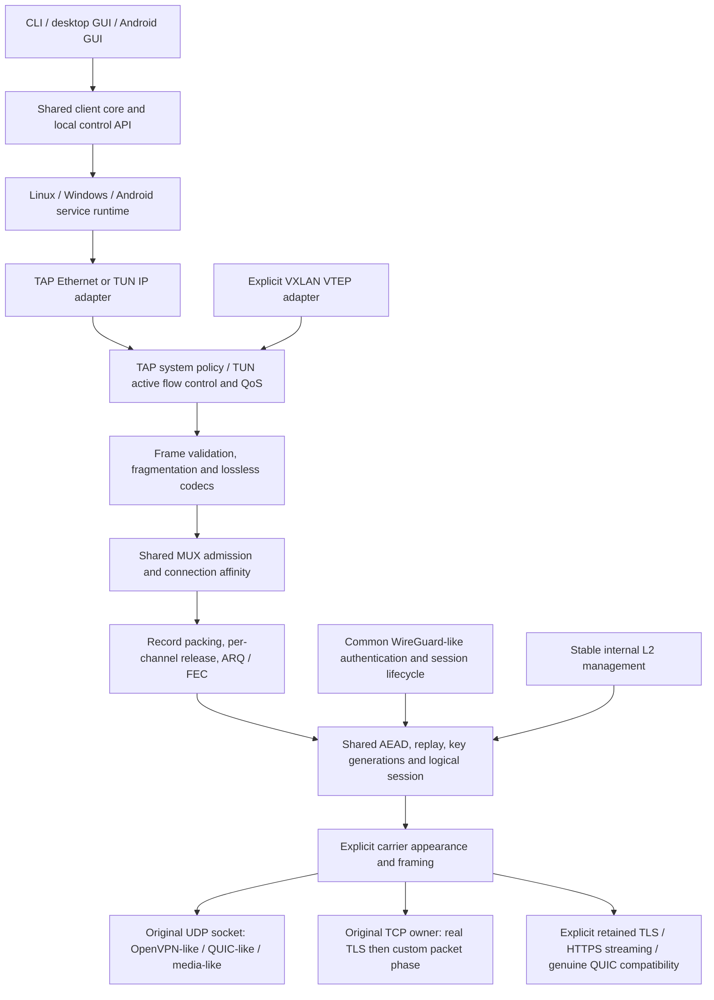

# Protocol architecture

Status: current-format cutover and verification in progress. Public Rust
protocol libraries remain independent of OS handles, clocks and async runtimes.
Swift and other record algorithms operate inside the selected same-owner carrier;
they are not independent connection defaults. Existing Linux component and
user-space integration receipts have finite scope.

The owner-authorized [current cutover](modules/compact-wire-cleanup.md) removes
obsolete production entry points and wire encoders; Git retains their history.
The owner explicitly approved deletion before every replacement capability is
ready. **Common active TUN credit and the Windows Common service entry remain
pending.** Their former entry points are not evidence that the current format
implements them. Portable helpers and Linux-hosted fixtures do not qualify a
Windows or Android runtime. No full mode or platform gate closes through deletion.
The subsequent explicit old-Records removal also retires the fixed and
refreshable final-wire wrappers. Fresh-DH integration with the sole current
Compact owner remains a required gap; the lower handshake/security primitives
and full lifecycle acceptance are retained. This is separate from negotiated
data-profile epoch switching.

Current Common Records use a five-byte kind/reader and packet-number prefix.
Data protection adds a 16-byte ChaCha20-Poly1305 tag by default (21 bytes total),
a 32-byte HMAC-SHA256 tag (37 bytes), or an explicitly selected four-byte CCM tag
or unkeyed CRC32C check (9 bytes). Management and recovery feedback use their
independent full-tag domain (21 bytes). Proxy records carrying lifecycle or
credit controls use the strong authenticated-data arm when ordinary data selects
a short check. These are record costs: algorithm union fields, packing, fragments
and the selected carrier remain additional. Raw IPv4/TCP adds 40 bytes, giving
49, 61 or 77 bytes before algorithm fields for the respective data selections;
its bootstrap geometry is separate. Genuine TLS and QUIC retain their mandatory
outer protection and transport behavior.

Selected Block FEC systematic records also transmit only their exact original
length-prefixed source extent. Existing reserved decoder rows restore the omitted
algebraic zero tail; repair equations retain their complete actual generation
width. Common configuration/catalog domains are v5 with unchanged policy bytes.
The [batch18 local evidence](modules/buffer-observability.md#coordinated-local-buffer-batch18-validation)
passes. [Native18](modules/buffer-observability.md#native18-exact-source-fill-and-remaining-admission-stalls)
observes zero Cauchy systematic fill; its selected data phases still fail their
original acceptance criteria. Native throughput and full acceptance gates remain open.

Rolling, Research and sliding repairs serialize the maximum encoded source
extent in their complete support. The receiver restores omitted zero columns in
bounded symbol storage; meaningful trailing zeros and the encoded source length
remain present. Current repair grammar and configuration versions must agree.
The [Rolling version regression](../work/compact-cutover-20261117/fec/rolling-version-parser-attempt2.log)
passes both current source formats and rejects prior version identifiers. The
actual UDP lost-source fixture and capture also pass, including meaningful
trailing zeros, held repair custody and actual byte charging. Runtime failures
from the broad attempt now have passing focused continuations; remaining client
service checks and aggregate closure are tracked in the cutover ledger.

See the [current verification and remaining work](modules/compact-wire-cleanup.md#evidence-and-remaining-work)
for source-bound receipts, failed attempts, captures and required aggregate-check
status. Ordinary overhead targets are not guarantees for every packet or mode.
The shared CLI/GUI service keeps requested and observed configuration separate;
API4 switches complete authenticated Common catalog entries, including native
compression policy, while API1 retains current proxy controls. Historical
checkpoint descriptions below do not preserve retired defaults or qualify the
current revision. All 47 P-* definitions, full SW-11, native/platform, raw-kernel,
resource, protocol-identification and measured QoS/performance gates remain in
scope.

The Batch16/17 closeout integrates authenticated same-owner reuse through API4,
precise Research feedback/physical ordering on original carriers, legacy
admission-time repair credit and actual source/repair batch packing, measured
Common physical receipt retention, and fixed/full raw TCP proxy composition with
bounded Aligned units. See [the closeout receipt](../work/parallel-features-20261115/parallel-closeout-scoped-validation.json).
Finite component and authenticated shared-service cases pass through preserved
scoped continuations. Raw cases use owned injected PacketIo; they do not qualify
kernel raw/TUN behavior. The required batch check and remaining stages are retained,
including 1,658 simulator passes. Its existing standalone OpenVPN impaired-close
failure remains open; no pristine full-suite result is claimed. Default-stack
construction and new fixture errors were repaired without renewing original caps.
The legacy 21-row oracle stops before physical completion, so its complete
feedback differential remains LAA-03. Full PCOR/PCO/PBA/RRP/PCOM, all47, SW-11,
native/platform/resource/performance gates retain their complete definitions.
Prior numbered checkpoint descriptions below retain their historical scope.

The Batch15 checkpoint integrates the existing measured TCP proxy controller
through retained Common original UDP and its explicit CLI/API1 presenter, bounded
Windows foreground status/disconnect/reconnect, and pure legacy sliding/hybrid
FEC components. See [the scoped Batch15 receipt](../work/parallel-features-20261115/parallel-batch15-scoped-validation.json).
The five measured selection/service/CLI cases, 14 legacy recovery and three explicit
coefficient cases, and 31 portable Windows cases pass. Required check stages and
affected Windows GNU lint/link pass through preserved continuations. The aggregate
QUIC timeout retains its passing same-binary retry with cause unqualified; optional
configuration stack growth and a Unix helper guard were repaired. This is not a
pristine single-invocation pass or native Windows execution. External receipts
remain source-bound history.
Legacy admission/packer timing still differs from the corresponding Python model
and is an active correction, not a completed parity claim. Native Windows, full
proxy/native-window, all47, SW-11, resource and performance gates remain open.

The Batch14 checkpoint implements explicit retained proxy EOF/ARQ retirement
and Common proxy CLI selection, plus actual Research Engine/Bank, original UDP
runtime and shared-service composition. The private per-connection reuse
prerequisite is protocol-tested; authenticated runtime reuse remains unfinished
and its capability stays false. See [the scoped Batch14 receipt](../work/parallel-features-20261115/parallel-batch14-scoped-validation.json).
All 14 new focused cases pass, including actual protected-UDP/shared-service
integration. The required full attempt and scoped continuations preserve initial
integration errors, a drain-fixture repair and a default-stack API repair; the
remaining required stages and affected Windows GNU lint/link pass. This is not
a pristine single-invocation suite pass or native Windows execution. Async Research
carrier ordering, complete PCOM/PCO/RRP deliverables, all47, SW-11 and full native,
platform, resource and performance gates retain their original definitions.

The preceding Batch13 integration brings three reviewed feature deltas into this
checkout: the existing fixed/full single-channel TCP proxy actor through actual
Common records and the shared service; the Windows foreground TCP/TLS TUN entry
point with a safe-dependency Wintun device; and pure recursive parity, fallback
and rolling-accumulator owners using the maintained GF/storage engines. See
[Common proxy](modules/common-tcp-proxy.md), [Windows Wintun](modules/windows-wintun.md)
and [research components](modules/research-recursive.md). External source-bound
receipts remain historical; current root validation is recorded separately in the
[Batch13 receipt](../work/parallel-features-20261115/parallel-batch13-scoped-validation.json).
The integrated checkpoint passes all 66 selected new/affected cases and the
remaining required check stages. The first full attempt retains two existing
runtime failures; each passed one same-binary recheck without a code change.
Their causes remain unqualified, so this is not a pristine full-suite pass.
Affected Windows GNU lint/link checks pass; native execution remains unverified. Windows native device
execution and complete proxy/Common acceptance remain open at their full existing
definitions. Batch14 above adds scoped retained close and Research runtime composition.
No new default carrier, periodic key exchange or reduced parity gate is implied.

The preceding Batch12 implementation installs the selected independent Compact
collection in the actual Engine/Bank/Common runtime and shared service, including
bounded source-free ACK custody with original arrival/deadline and observable
fixed-cohort limitations. It adds explicit authenticated Rolling input custody and
selected fragment Engine/Bank/runtime composition, with whole-group charging,
fresh per-fragment protection and physical completion. The original raw TCP
Full/Half owners now feed the same Common service and strict CLI, with genuine
TLS/member and initial Noise/member admission, fresh lower reconnect and unchanged
setup caps. These are implemented slices with finite protocol/protected-I/O
receipts, not complete named Python profiles or kernel/platform qualification.

The [Batch12 scoped receipt](../work/parallel-features-20261115/parallel-batch12-scoped-validation.json)
retains actual source identities, failed attempts, focused continuations and the
required batch check separately. See [independent owners](modules/connection-records.md),
[Rolling ingress](modules/common-rolling-ingress.md),
[record fragmentation](modules/common-record-fragmentation.md) and
[raw Common carrier](modules/raw-common-carrier.md). Full flow reuse, the named
1460/1500/global8192/local128/every16/copies/ACK composition, native/platform/
resource/performance, all47 and complete SW-11 remain open. External Windows,
recursive-FEC and TCP-proxy/Common commits were excluded from that preceding
checkpoint; they are integrated in Batch13 above.

The preceding Batch11 implementation adds explicit bounded benchmark ACK ingress
through actual Engine/Bank/Common ownership, requested/effective APIv4 policy and
paired resource binding; decoded-channel reverse learning in the same Pipeline;
and a pure fixed-cohort collection of independently reserved Compact owners.
Finite cases pass actual ACK backpressure and record switching, independent-owner
source/feedback loss, genuine catalog-bound Compact service setup/switching and
Rolling silent-tail native progress. These are distinct compositions: the complete
independent16 profile, raw TCP/Common installation and named8192/128/copies/ACK
profile remain open. See [ACK ingress](modules/common-ack-ingress.md),
[independent owners](modules/connection-records.md) and
[Compact composition](modules/compact-endpoint.md).

The [Batch11 scoped receipt](../work/parallel-features-20261115/parallel-batch11-scoped-validation.json)
retains109 distinct focused passing leaves and the exact failed attempts. Full
workspace formatting and Clippy pass; successful Rust targets/doctests total1,750,
with524 additional runtime passes and one streamed UDP WouldBlock failure. That
unchanged case passes an isolated rerun; its concurrent failure cause remains
unresolved. Affected rustdoc passes. The full check remains failed and its later
stages were not reached. This is not full Python, native or throughput acceptance.

The preceding [Batch10 scoped checkpoint](../work/parallel-features-20261115/parallel-batch10-scoped-validation.json)
installs explicit AlignedCompact/PackedCompact policies through actual reserved
Engine owners and the original UDP Driver. Finite integration covers lossy source
and feedback, retained authenticated feedback across delayed physical receipts,
L3 TCP context/delta/replay, exact native bytes and negotiated record switching.
All16 affected Common cases pass. Both Compact forms refuse unsupported physical
copy counts before provisioning while retaining the complete requested policy.

The full check passed workspace Clippy and formatting, with1,739 passing Rust cases
in successful targets plus522 runtime passes; one legacy Packed pressure case
failed. Its production staging loop now stops retrying unchanged sealed work in
the same burst: all22 affected Aligned/Packed cases pass with original limits and
timeouts. The two Compact endpoint/capability cases and affected strict checks
also pass. Earlier failures remain preserved; these continuations are not a full
check pass, and later full-check stages were not reached. Genuine new-profile
service setup, complete named Python topologies, native/platform/resource/
performance, all47 and full SW-11 remain open. See [actual composition](modules/compact-endpoint.md).

The preceding [Batch9 scoped evidence](../work/parallel-features-20261115/parallel-batch9-scoped-validation.json)
adds finite selected CompactARQ/Python-event differential and Reliable R0 passes,
actual UDP Rolling three-copy delivery/switching, shared production proxy CLI
adapter/Unix lifecycle checks, and native-IP codec/Aligned/Packed protocol tests.
These are separate finite compositions: selected Compact Common installation and
L3 runtime/native integration remain open. The exact Aligned FIFO pressure repair
passes, while Packed pressure still fails under its original caps. Full-check
attempt2 passed 1,735 Rust cases and 65 Python tooling cases before a runtime loss
fixture stack overflow aborted its test binary; the simulator stage was not reached.
That fixture now stores its actual Driver in the existing fallible StateCell:
all five affected loss/liveness cases pass with unchanged stack limits, timeouts
and assertions. The earlier Clippy failure is also corrected. Affected format,
strict Clippy and rustdoc pass; these continuations are not a whole-batch pass.
Full Python behavior, native, resource, platform, all47 and SW-11 gates retain
their complete definitions.

The preceding [TCP scoped checkpoint](../work/parallel-features-20261115/parallel-tcp-scoped-validation.json)
adds independent verified SNI, retained raw send observations, supported CLI naming
and actual fixed/measured shared-service readiness/cleanup. Affected strict checks
and finite TLS/Unix-device cases pass; failed attempts remain preserved. At that
checkpoint, production
proxy CLI migration, Python behavior alignment and complete native/platform/
resource/performance gates remained open; the finite CLI follow-on is recorded
above. See [naming](modules/tcp-carrier-naming.md),
[proxy service](modules/tcp-proxy-service.md) and [Python alignment](modules/python-behavior-alignment.md).

The preceding [Wave8 checkpoint](../work/parallel-features-20261115/parallel-wave8-scoped-validation.json)
implements [physical ARQ send confirmation](modules/arq-physical-send.md) through
Reliable/Aligned/Packed/Common, [same-flow transient UDP recovery](modules/common-flow-recovery.md),
[explicit short-source copy selection](modules/source-copy-policy.md), and
[committed Rolling feedback snapshots](modules/rolling-storage.md).
Affected protocol/runtime cases and strict checks pass; failed aggregate attempts
remain preserved. Real8192/local128/every16 old-hole recovery is finite component
evidence. Copy selection is implemented in the codec; authenticated policy and
repeated physical sends remain SCP-04. Same-flow recovery retains the original
socket/session and deadlines; replacement/restart reconciliation remains SEC-08.
No periodic fresh-DH or new cryptographic replay domain is selected. Reconnect
remains in the underlying service. Native and full-stage evidence is recorded
separately; all47 mode gates, full SW-11, complete resources, Windows/Android and
80 Mbit/s performance remain open.

That Wave8 checkpoint preserved open aggregate failures. Its
`tools/check.py` invocation failed in the legacy Packed pressure case and runtime
fixture stack limits; its successful stages and exact continuations are retained.
The full simulator passed 1,658 cases. Three current Linux native cases passed;
the fourth requires a retry after bounded receipt-publication tooling was fixed.
Unverified legacy actor and fixture repairs are excluded from this checkpoint.
No full-suite pass or completed four-case current native matrix is claimed.

The preceding [scoped checkpoint](../work/parallel-features-20261115/parallel-wave7-scoped-validation.json)
adds implemented and protocol-tested [Rolling independent-short delivery](modules/rolling-records.md)
and four finite [production Common native CLI cases](modules/common-carrier-cli-native.md).
TAP/TUN with both inner appearances pass genuine outer TLS/member and inner
Noise/member authentication, all64 catalog inspection/paging, four-family
switching, exact bytes/liveness, runtime-failure API survival, fresh-session
reconnect, capture and cleanup. One representative per family is activated;
this is clean Linux IPv4 integration evidence, not full catalog or early-short
native acceptance. The shared service retains the management API after an
established backend fails. Automatic retained-state recovery, optional fresh-DH
installation, full SW-11, all47 modes, complete resources, Windows/Android and
80 Mbit/s performance remain open. No periodic exchange or new replay-domain
wire decision is introduced.

The preceding [record checkpoint](../work/parallel-features-20261115/parallel-wave6-scoped-validation.json)
provides explicit ARQ-only Aligned/Packed and finite Packed short gap/expiry
evidence. Its receipts retain their original Unix packet-device/pure scope.
Earlier checkpoint descriptions below report their then-qualified scope; current
native evidence is the finite CCN-01/02 leaf above, not completion of its parents.

The preceding finite carrier integration binds requested Common plans to
genuine outer TLS/member proofs and runs the existing Noise/member and
four-family Common Driver through the shared service on the original socket.
Explicit OpenVPN-like CLI selection uses a complete outer policy and separately
selected inner cover; status retains requested E0 and effective E1/catalog
identities. See the [carrier service
contract](modules/common-carrier-service.md) and [scoped
evidence](../work/parallel-features-20261115/parallel-wave5-scoped-validation.json).
This remains initial-only; automatic retained recovery, fresh-DH installation,
production native CLI startup, full mode/resource/platform and performance gates
remain open.

The preceding finite wave4 adds three functional components: an explicit
[initial-only Common runtime on the original public carrier](modules/managed-common-runtime.md),
[typed fresh reconnect after backend failure](modules/generic-client-service.md)
and [external Common control/inspection CLI](modules/common-client-api.md)
against programmatic shared owners that perform actual authentication. The
[last passed receipt](../work/parallel-features-20261115/parallel-wave4-cases-attempt-3/validation.json)
records nine exact cases in 7.936 s and the both-cover CLI probe in 4.131 s; preserved
wave4 runs contain 26 distinct positive cases, not 26 features. Clock and structural
stack repairs have exact affected evidence. Managed contract/controller evidence
remains finite pure protocol testing. Initial-only operation adds no periodic
fresh-DH; reconnect belongs to the underlying carrier/session service, not Swift
or the GUI. The [final scoped validation](../work/parallel-features-20261115/parallel-wave4-scoped-validation.json) records successful runtime-only Build4,
both final affected regressions and affected strict Clippy/rustdoc/format
checks, plus checklist and diff checks. Full `tools/check.py` was not run,
avoiding unrelated suites.
Production CLI connect/serve/TAP startup, full carrier service, automatic retained
recovery, all 47 mode gates, SW-11/RLNC/parity/rolling/packed/proxy, complete resources,
native/platform and performance definitions remain required and open.

## Required Python behavior alignment

The [named Python alignment contract](modules/python-behavior-alignment.md)
requires actual recovery ownership, feedback loss/budget, retry timing, codec and
ACK policy parity with each explicitly identified experiment configuration.
The historical per-connection CompactARQ78.7502 Mbit/s reference and the shared
Packed Mux16 C46/C47/C48 candidates are separate compositions. Common integration
is not evidence of either complete algorithm. Replace incorrect selected Rust
behavior; keep historical receipts and explicitly versioned compatibility only.

Priority is L3 TCP, with L2 retained and improved. CompactARQ serial/RTT/ACK-delay/
guarded retries, complete8192/128/every16 with actual short copies and ACK
coalescing, and separately selected per-flow/shared recovery remain required.
Lossy algorithm feedback must not use a reliable side channel. Authenticated
reliable management, common security, selected-carrier continuity and every
existing mode/SW-11/platform/resource/performance requirement remain in scope.
No new default profile or owner wire decision follows from this source audit.

The optional C48 forward repair profile binds a separate forward grammar in the
authenticated Common catalog. Eight consecutive first transmissions can earn one
extra GF(256) equation. Its independent group number leaves local and global
repair serials, reverse feedback, named retry and silent-oldest recovery intact.
Its current runtime uses the original UDP socket's all-traffic accepted IP byte
counter. The gate estimates local serialization from that counter and the
configured pacer. See [wire costs and measured scope](modules/frame-channel-experiment.md#negotiated-eight-source-forward-repair).

## Reviewed target and implementation boundary

The 2026-11-13 owner discussion confirmed a fixed point-to-point deployment for
studying tunnel transport and QoS between controlled endpoints. The target uses
one shared internal secure-session protocol across explicitly selected carriers,
including TCP/HTTPS-like. Swift remains a packing/recovery algorithm inside it.
The owner preferred lightweight WireGuard-like authentication and session lifecycle,
while retaining Swift's encrypted and authenticated data. The preceding TLS-based
bootstrap is the integration boundary being replaced; data security is retained.

The [secure-session contract](modules/secure-session.md) separates those confirmed
requirements from unselected dependencies, wire formats, key/provisioning APIs,
timeout values and migration policies. Its SEC-* parent gates remain open. The
following are evidence boundaries, not a declaration that the target is running:

| Area | Current evidence | Target gap |
| --- | --- | --- |
| Pure protocol libraries | Typed bounded engines with injected time/I/O; actual reserved Swift/Aligned/Packed/Rolling owners, Pipeline/MUX, two-slot Bank and shared native storage/counts. Rolling has complete tag4 configuration and exact actual nested heap plans. | Complete nested/external allocator qualification and full selected-runtime acceptance; preserve pure boundaries through common security/carriers. |
| Swift | Historical TLS/separate-UDP receipts remain preserved. The explicitly selected QUIC-header/media-like path composes same-socket Noise/member authentication, common AEAD, Swift records and policy control through the shared service; socket/device fixtures and finite Linux CLI/TAP baselines now exist. | The full native matrix and impaired 80 Mbit/s target, complete session lifecycle, every other carrier and full SW-11. |
| Common record runtime | Explicit Common Driver uses the actual reserved four-family Bank on the original authenticated UDP pair. Finite Unix packet-device cases pass nonempty Swift/Rolling/Aligned/Packed switching, explicit GF work, real repair and physical custody. Shared typed service/APIv4 and four production Linux TAP/TUN cases have finite cross-profile, failed-backend API survival and fresh-session evidence. | Complete resource/fault/lifecycle matrices, retained recovery, fresh-DH installation, full SW-11 and platform/performance qualification remain open. |
| Genuine QUIC | Maintained QUIC connection with DATAGRAM data and scoped historical Linux native receipts. | Keep distinct from the owner's QUIC-header-only appearance profile and its shared-session integration. |
| OpenVPN-like UDP | Preserved custom-gate native slices; additive outer-wire/control codec and actual same-socket TLS/member carrier. The selected shared-session Common Driver/service and finite APIv4 case exchange all four actual record families without exporter resealing, including explicit ARQ-only Aligned/Packed. | Production TAP/TUN CLI now has four finite clean cases; complete factory/service fault and resource matrices, standard-dissector capture and full native/platform/ISP qualification remain open. The historical custom 144-byte gate is a separate path. |
| HTTPS | Focused real TLS/HTTP2 streaming code; separate raw TLS-to-packet owner and four historical clean Linux integrity cases. | HTTP2 does not satisfy the requested TCP/TLS-to-ACK-independent packet path; broader raw feasibility remains open. |
| Platforms | Linux has named, finite native compositions. Windows has an explicit foreground TCP/TLS TUN implementation with portable and cross-build evidence; Android has no JNI/VpnService. | New common-session support, Windows and Android execution are unqualified. |

The [fourth record-family checkpoint](modules/rolling-common-records.md) is an
actual pure Engine/Bank composition with explicit rolling work and move-only
carrier output confirmation. Existing v2 bytes for tags1..3 remain unchanged;
older readers reject the additive tag4. The subsequent
[selected rolling runtime](modules/common-rolling-runtime.md) installs actual
bounded work and physical confirmation; absent explicit work still refuses it.
The [managed initial handoff](modules/managed-initial-handoff.md) proves the real
selected Noise/Joining/member authority chain on the original UDP socket, while
[original datagram custody](modules/original-datagram-custody.md) supplies actual
whole-write tickets for UDP/OpenVPN. The
[actual carrier factory](modules/openvpn-common-factory.md) now retains real
outer proof, selected Noise/member authority and original Parts. The
[four-stream Lifecycle owner](modules/lifecycle-control.md) has finite protocol
evidence, while [Common APIv4](modules/common-client-api.md) has finite actual
local service evidence. Common runtime fresh-DH remains open. The later
[carrier service](modules/common-carrier-service.md) and
[native CLI leaf](modules/common-carrier-cli-native.md) install the initial-only
OpenVPN Driver/service path with their own finite evidence.

The owner relaxed QUIC-like to header appearance without native QUIC data ACK or
congestion semantics, and added minimal audio/video media appearance rather than
a full WebRTC stack. This does not relax the original OpenVPN wire-handshake gate
or the original HTTPS-like raw requirement. Full endpoint interoperability is not
required. Standard-header parsing, complete protocol validity, identification and
ISP QoS treatment are separate claims; initial-packet classification is an
unverified hypothesis to measure on the actual connection.

The first implementation correction now extracts Swift's packet protection into
a reusable pure library while preserving its v2 wire bytes. New pure Noise,
appearance, protected User/Control records and reliable control components have
finite protocol/loopback evidence in their
[module ledgers](implementation-checklist.md#reading-order-and-detailed-task-lists).
The same-socket library fixture is distinct from selected shared-service,
native-device and performance acceptance. Those target gates have separate
evidence; no default carrier or automatic retained-state recovery is silently enabled.
Existing Ed25519 identity and multi-channel Swift records now live in pure
libraries. Shared client-core factories compose admission, Noise and member
proof on the original connected UDP socket. The
[frozen-source aggregate](../work/shared-session-client-20261113/validation.json)
passed local Linux checks, including actual factory authentication followed by
protected Swift and fixed control over both appearances on the original UDP pair.
The
[runtime/client ledgers](modules/client-secure-udp.md) separate authenticated
factory completion and finite transport tests from selected CLI/service/native
readiness. Actual authenticated prologue values, final-flight custody and the
original operation deadline remain owned through each handoff.

The [original-socket driver](modules/secure-udp-runtime.md) and
[shared service/CLI integration](modules/secure-udp-service.md) now have a
[source-stable focused receipt](../work/secure-udp-integrated-focused-20261113/attempt-3/validation.json).
It covers actual connected UDP, independently owned runtime fixtures, readiness-capable
Unix datagram packet devices, common AEAD/control, authenticated Swift policy
changes, liveness, cancellation and fresh manual reconnect. The CLI selects
`quic-like` or `media-like` separately from `--record-profile swift`, uses explicit
manual credentials, and exposes the shared version2 service API. This is not
actual TAP/TUN performance, default state-retaining recovery, fresh-DH rekey,
generic management dispatch or full SW-11. The
[native lab](modules/secure-udp-native.md) tracks those finite CLI/TAP measurements
separately from all remaining carrier, platform and ISP requirements.
The [preceding deadline-correction aggregate](../work/secure-udp-native-progress-20261113/attempt-1/validation.json)
also passed with unchanged inputs. Subsequent [immutable native baselines](modules/secure-udp-native.md#initial-immutable-native-baseline)
passed clean/delay QUIC-like cases and functional policy/reconnect/integrity checks
for both appearances; both 15%-loss cases failed the unchanged performance target.
Later deadline and ready-work corrections have separate focused evidence and
require their own build/native qualification. No baseline result is promoted to
full lifecycle, carrier or platform completion.

The owner-requested [performance-counter correction](modules/secure-udp-native.md#counter-guided-performance-correction)
adds bounded runtime/channel observations through the shared service API. It
separately corrects the CLI's too-small forward burst and drains already-writable
native output before the next UDP batch using the original per-turn quota.
Finite QUIC-like impaired measurements improve from40.0928 to64.5727 and then
70.6236Mbit/s; the80Mbit/s gate remains open. Reported native-pressure rejection
is removed in build7, while remaining pacer/CPU and saturated-read fairness need
their own evidence. The same preserved old binary now measures71.4825 clean,
so its historical83.0069 is not promoted to a current environment baseline.
Requested kernel profiling then locates network and epoll/futex execution; the
separately verified one-shot IPC helper correction measures77.3464Mbit/s
impaired in build8, still below80, without changing daemon scheduling.
SUR-11 subsequently reproduces saturated UDP starving queued native input in the
actual loop, then corrects ready-I/O priority with unchanged work quotas and
deadlines. Build9 records78.6206/78.2435Mbit/s for QUIC-like/media-like forward16
and separate bidirectional stress; all four pass functional/cleanup checks, but
both forward results fail80. The [native ledger](modules/secure-udp-native.md#saturated-ingress-fairness)
keeps these outcomes distinct from the source-bound simulator workload audit.
Pure observations and focused protocol/runtime tests remain separate from
source-pinned native measurements, complete mode/lifecycle acceptance and ISP QoS.
The [preceding required aggregate](../work/secure-udp-performance-progress-20261113/attempt-3/validation.json)
passes with unchanged source inputs; this local check does not complete the
remaining native performance, recovery, carrier, mode or platform gates.
The scheduler checkpoint has a separate [source-stable required pass](../work/secure-udp-fairness-progress-20261113/attempt-2/validation.json)
with 1528 Rust cases including doctests, 295 Python tooling cases and 1658 simulator cases. Its conditional framing-capacity calculation
is an engineering assumption check, not a waiver of the80Mbit/s target.

The subsequent [bounded capture and setup diagnostics](modules/secure-udp-diagnostics.md)
correct IPv4 option validation and retain actual typed setup stages/counters
through the shared client/service API without changing protocol or retry behavior.
Their required source-stable workspace check passes. A fresh complete 16-case
Linux ABBA matrix verifies bytes/control/policy/manual reconnect/capture/cleanup;
all eight impaired cases still fail 80 Mbit/s at about 78 Mbit/s. Separate
same-binary kernel perf observes reduced system CPU and context switches with
current-thread, without a throughput gain. These are finite observations with
explicit profiler and shared-host limitations, not a default-runtime decision,
complete lifecycle/platform acceptance or evidence of ISP classification.

The next reusable dependency now has a [whole-message custody ledger](modules/control-messages.md)
and an [explicit control-stream ledger](modules/control-streams.md). Existing LX
fragmentation and SelectiveRepeat carry genuine 354/2762-byte PREPARE envelopes
through smaller windows with separate complete-message acceptance. Independent
Transaction/Liveness/DataFeedback contexts remain inside one common Control
security owner and shared wire allowance. Both-cover original-socket fixtures
complete 130 Ping/Pong rounds during a blocked transaction, then recover PREPARE
without applying it. The selected runtime still uses its existing control
contract; generic dispatch, retired-retry permits and full SW-11 remain open.
Its [source-stable required aggregate](../work/common-control-messages-20261113/aggregate-attempt-3/validation.json)
passes 1555 Rust cases including doctests, 295 Python tooling cases and 1658
simulator cases. No new native or platform result is inferred from that pass.

The additive [leased transaction checkpoint](modules/control-streams.md#leased-transaction-checkpoint)
now preserves the original operation deadline and source digest through generic
commit/retire and final message custody. Both-cover original-socket tests exercise
exact retired-origin retries, 130 liveness rounds and real submission/acceptance
backpressure. An explicitly bound Gate dispatches the existing Peer before
committing its envelope sequence; borrowed message proofs distinguish queued
acceptance from peer-confirmed whole messages. This does not switch a native data
profile, enable the contract in the selected service or qualify full SCS-05/SW-11.

The subsequent [explicit Swift runtime backend](modules/streamed-swift-control.md)
composes independent control streams in the actual original-socket driver and
authenticated client Profile. Whole-message custody and original operation caps
remain after a Swift policy outcome; target-scope commands wait for actual reader
settlement while Liveness continues. The focused and required frozen-source workspace checks pass. This is
explicit embedding selection, with unchanged CLI defaults and local API schemas;
generic Management/DataFeedback, full SW-11 and native saturation remain open.

The additive [generic Swift runtime](modules/generic-secure-udp.md#current-explicit-runtime-checkpoint)
now has explicit runtime-library and shared Prepared/service/APIv3 selection in
that same sole I/O loop. Finite Unix tests use actual original UDP sockets,
maintained authentication, canonical H0/D0 scopes, reserved engines and physical
native writes through two nonzero asymmetric switches. The actual shared service
also passes both-cover traffic, complete-C/key operations, IPC v3 status/switch,
liveness and fresh-session reconnect with periodic reporting disabled. Actual
observations precede successful completion; requested/current/physical values
and incomplete resources remain distinct. All three generic control streams
now use actual reserved ARQ backing; sole-loop inputs are charged and moved once.
The additive [complete-plan CLI](modules/generic-transaction-cli.md) now exposes
explicit generic selection, complete-C APIv3 commands and bounded full-catalog
inspection. Its [source-stable batch](../work/generic-transaction-cli-20261114/aggregate-attempt-2/validation.json)
passes1960 Rust cases including doctests,376 tooling cases and1658 simulator
cases. The external probe executes34 real CLI processes per cover against
actual authenticated shared-service owners and UnixDatagram PacketDevices,
including2 switches and fresh reconnect. It does not qualify successful
production CLI TAP/TUN startup. Existing defaults and fixed v1/v2 bytes remain
preserved. The complete generic IPC/negative-service/fault matrix, full
reservation, cross-profile SW-11 and broader carrier/lifecycle/platform/performance
acceptance remain open. No new native or performance run is inferred.

## Library boundary and layering

The diagram is conceptual: classification precedes codec selection; the shared
arbiter admits records into recovery; encoding may batch across admitted channel
records. Authentication, replay checking and bounded parsing precede decoder
state mutation on receive. Session control sits alongside the pipeline and uses
bounded, rate-limited service; it cannot give user probes a privileged data path.

The public `l2tunnel` facade exports runtime-independent crates. The eventual
engine accepts caller-provided packets, time and configuration events, and emits
bounded actions. Tokio, JNI, Windows handles, Linux capabilities, socket setup,
DNS, config files and logging sinks belong outside that engine. No library
changes routes, opens a device or calls process exit as a side effect.

A carrier lane is an authenticated physical transport connection. A MUX channel
is an ordering/admission domain. An inner flow is a classified user connection.
These counts are independent; the simulator's 16-channel comparison does not
require 16 physical TCP connections. Keep separate fields and metrics for each.

The current runtime still has four audited integration gaps, tracked as blocking
[FIX-01 and FIX-10 through FIX-12](implementation-checklist.md): independent
storage/native-flight/recovery budgets, interchangeable carrier and user recovery,
a negotiated stable session control envelope, and a shared client lifecycle.
Focused base UDP/QUIC/raw delivery integration addresses the first boundary;
the pure common-control codec and managed TCP service address parts of the other
three. The service owns accepted setup deadlines, cancellation and reconnect
cleanup; portable command types are separate from Unix IPC. Other profile
lifecycle paths and negotiated common-control dispatch remain open. These do not complete the
conceptual stack or authorize unchecked combinations. Each composition must
bind its selected policies before I/O and reject unsupported combinations.
The newer common-session correction is tracked by FIX-13 and SEC-*; a service
wrapper around Swift's current dual-flow design does not satisfy it. The CLI and
GUI share one service API and report requested/effective carrier, appearance,
protection, data profile, recovery state and unsupported capability reasons.

## Connection bootstrap, authentication and multistream joining

The existing retained-TLS compatibility implementation uses maintained rustls,
TLS 1.3 and a persistent TCP socket. Its contract and historical tests remain:

1. Dial the endpoint IP/address independently of the optional TLS server name.
   Complete TLS with server identity checked against configured trust roots or a
   pinned server public key. Absence of SNI must not disable certificate checking.
2. Inside TLS, exchange a bounded version/capability offer and fresh nonces, then
   authenticate tunnel membership. Initial design uses provisioned Ed25519 member
   keys and an allowlist; short-lived join credentials are derived after auth.
   Private keys never appear in logs, command lines or example configs.
3. Sign a domain-separated transcript containing both roles/nonces, server and
   member identity, TLS exporter binding, session ID and complete capability
   offer/selection digest. Server proves acceptance over the same transcript.
   Do not release user frames until both sides finish authentication.
4. Derive separate secrets for lane joining, control authentication and optional
   inner data protection using purpose-specific exporter labels and standard
   HKDF. The public RFC 9266 channel-binding value is not a secret MAC key.
   Disable 0-RTT for authentication, joining, configuration and user data in v1.
5. Each added physical lane completes its own TLS handshake and proves a one-time,
   expiring join token bound to its own exporter, session, role, direction and
   lane ID. This prevents transplanting another connection into the session.
6. Negotiate resource budgets, physical lane count, MUX channels, duplex policy,
   carrier capabilities, packet layer, codec/recovery profile and config digest.
   Unknown mandatory features fail closed; optional fallback is explicitly agreed.
7. In the retained-TLS profile, continue using the **same TLS object and TCP socket** for that lane's records.
   No reconnect, new SYN or socket replacement occurs at the auth/data boundary.

Key exchange therefore precedes tunnel-member authentication, while TLS server
verification protects that exchange from interception. TLS sequence numbers,
TCP byte sequence numbers and our tunnel packet numbers are distinct spaces.
TLS record counters are managed by the TLS library. Our counters never reset on a
mode change, and rotate keys/session before exhaustion. Current public APIs support
root/name verification with SNI disabled; configurable independent SNI and a public
pin verifier remain implementation gates rather than implied existing support.

The new target replaces the separate TCP/TLS-bootstrap dependency with one shared
message-oriented WireGuard-like authentication/session layer. Reuse maintained
key-exchange and cryptographic implementations. Specify loss/reorder/duplicate
handling, cookies, original handshake deadlines, anti-amplification, key confirmation,
replay protection, expiry and rehandshake before releasing data. Bare Noise or
copying two packet formats does not implement that complete lifecycle.

Both endpoints must authenticate the selected carrier/appearance, packet layer,
roles, fresh session identity, full configuration digest and capability/resource
selection. Retain purpose/direction/lane-separated secret derivation and fresh
packet-number domains without extracting private library state. Existing member
credentials and lane requirements remain until a reviewed binding is specified;
the point-to-point deployment does not require account or device-enrollment work.

Use the selected carrier's **same connection or UDP socket and five-tuple** through
authentication, data and ongoing control. A TCP authentication flow followed by a
different UDP data flow cannot satisfy this target. For HTTPS-like, outer real
TCP/TLS is still required and the authenticated transition must retain the original
TCP owner, ports and coherent sequence space. That outer handshake is distinct
from the common inner peer-authentication protocol; their exact binding remains
a SEC-03/SEC-09 acceptance gate. Independent UDP traffic has no required TCP side
channel. Additional lanes still need authenticated joining and domain separation.

References: [TLS 1.3](https://www.rfc-editor.org/rfc/rfc8446.html),
[TLS exporter channel binding](https://www.rfc-editor.org/rfc/rfc9266.html),
[rustls exporter API](https://docs.rs/rustls/latest/rustls/enum.Connection.html#method.export_keying_material).

## SNI, cover protocols and probing

The retained-TLS implementation has `sni = off`; rustls exposes an explicit
`enable_sni` setting. The target retains an operator-configurable SNI policy. A separate
operator-configurable name can be sent when a cover endpoint requires it. That
name becomes visible without a separately qualified ECH deployment, so it is
mutually exclusive with the strict no-SNI profile. Neither a free-form name nor
no-SNI permits accepting arbitrary unauthenticated certificates. Pinned identity
and the cover name are separate settings; never implement an accept-all verifier.
[rustls client configuration](https://docs.rs/rustls/latest/rustls/client/struct.ClientConfig.html)

There is no defensible guarantee of an unprobeable service or automatic router/QoS
acceptance. Acceptance tests instead check no tunnel-specific unauthenticated
banner, bounded handshake work, generic unauthenticated application failures,
anti-replay and measured behavior under active probes. TLS behavior itself and
packet sizes/timing remain observable. Packet-entropy and traffic-shape matching
are explicitly outside the requested scope.

Cover profiles have explicit protocol and compatibility requirements:

| Profile | Meaning and gate |
| --- | --- |
| `openvpn_like` | Preserve the original actual OpenVPN-format control-handshake and corresponding outer-layout requirement. Internal payload remains ours; full endpoint interoperability is not required. The current custom prefix/gate does not close this composition gate. |
| `quic_like` | Owner-selected header appearance over the original UDP socket. Native QUIC data ACK, congestion and full protected-frame validity are not required. Keep genuine QUIC as a distinct implemented compatibility/comparison capability. |
| `media_like` | New minimal audio/video RTP-like appearance on the original UDP socket. Exact fields are proposed protocol work; no full ICE/DTLS-SRTP/SCTP/browser stack or codec interoperability is required. |
| `https_like` | Original requirement: real TCP/TLS handshake, then authenticated custom TCP-shaped packets on the same ports and sequence space, with user-data recovery outside ordinary TCP ACK-driven transport. This ceases to be genuine TLS/HTTPS after transition. |
| `tls_stream` | Retained compatibility profile with valid TLS records over the original TCP connection; not automatically HTTP. |
| HTTPS streaming | Separate compatibility work with actual HTTP request/response, matching ALPN and authenticated streaming, e.g. HTTP/2 DATA. Preserve its own bounds and unauthenticated handler; it does not replace `https_like`. |
| `l2tp` | A genuine L2TP adapter if required. v2 is UDP/PPP; Ethernet pseudowires require the v3 Ethernet profile. Specify encapsulation, session state and packet overhead before enabling. |
| `raw_tcp_experimental` | Custom packet carrier, separately qualified; cannot claim valid HTTPS after leaving TLS record semantics. |

See [L2TPv2](https://www.rfc-editor.org/rfc/rfc2661.html) and
[Ethernet over L2TPv3](https://www.rfc-editor.org/rfc/rfc4719.html).
These names describe target contracts, not new accepted CLI values. Existing
library/CLI selectors and their actual limits remain visible until integration.
L2TP and broader raw deployment remain independent qualification gates.

## TCP, raw TCP and UDP capabilities

The operator explicitly selects the carrier/appearance. Unavailability fails
unless a fallback was explicitly configured; an automatic raw/TCP/UDP preference
must not override that choice. Carrier delivery semantics, outer appearance,
Swift/recovery, native layer and duplex scheduling remain separate capabilities.
`Availability` must describe implemented, permission-checked, path-qualified
backends, not OS guesses or enum presence. Current compatibility paths retain
their existing identities and evidence; no new selector is enabled by this design.

| Backend | Preserved behavior | Important constraints |
| --- | --- | --- |
| `tcp_tls` | Original socket, 4-tuple, TCP sequence and TLS state persist after auth. | Reliable ordered delivery, kernel congestion/window/retransmission, outer HOL. Overlay FEC cannot release bytes stuck behind TCP loss. |
| `udp_authenticated` | Target: common authenticated session on the original UDP socket, with independent protected packets and lane identities. Current base UDP/Swift still have separate TLS control. | Datagram loss/reordering available to custom ARQ/FEC; own pacing and congestion safety required. UDP can be explicitly selected and is never an auth downgrade. |
| `raw_tcp_experimental` | Goal: original 4-tuple and coherent sequence evolution through bootstrap and packet phase. | Needs packet ownership, permission, state tracking and path tests; not provided by a normal TCP socket. |

Ordinary TCP cannot send indefinitely while ignoring ACKs: ACK progress controls
its send window and recovery. On Linux `TCP_QUICKACK=0` is only a nonpersistent
hint to leave quick-ACK mode. Measure it per socket; do not change global TCP
settings or promise a specific delayed-ACK ratio. TCP_NODELAY affects Nagle,
not receiver ACK obligations. Keep inner TCP ACK handling separate from these
outer settings. Windows/Android settings are capability-probed rather than
pretending Linux socket options are portable.
[Linux TCP semantics](https://man7.org/linux/man-pages/man7/tcp.7.html),
[TCP ACK requirements](https://www.rfc-editor.org/rfc/rfc9293.html#section-3.8.6.3)

Raw TCP design gate:

- Prefer one userspace packet owner from SYN through shutdown, including a reliable
  ordered bootstrap stream for TLS. Do not assume a kernel TLS socket can be
  detached and inherited by copying sequence numbers. A kernel-handover variant
  requires a separately reviewed ownership/rollback specification first.
- Explicitly model SYN/FIN consuming sequence space, payload byte accounting,
  modulo-32-bit sequence comparisons, ACK/window policy, retransmitted segments,
  timestamp/PAWS/options, checksums, MTU/PMTUD, RST ownership, NAT idle time and
  reconnect. No host-wide RST suppression is permitted in normal operation.
- TLS authentication may negotiate an independently authenticated datagram packet
  phase on the same tuple. It is then a custom carrier, not ongoing TLS/HTTPS.
  Its inner packet numbers and cryptographic nonces are independent of TCP seq.
  The common inner security protocol must be bound to that authenticated ownership
  transition; replacing bootstrap does not permit skipping the outer TLS gate.
- Capture both sides across Linux conntrack/NAT and representative target routers;
  test loss, gaps, delayed ACK, sequence wrap, reordering and long idle. Reusing a
  tuple/sequence alone does not prove middlebox acceptance. If it cannot meet the
  deployment gate, fail visibly or use only an explicitly authorized fallback and
  expose the reason. An irreversible packet-phase seal cannot roll back to TLS.

On Linux, opening a raw socket alone does not stop the kernel TCP handler from
sending RST or ACK traffic. The current raw opener requires CAP_NET_RAW, rejects
the initial namespace and validates an existing exact-tuple marked RST policy.
The caller/lab must separately prove namespace ownership; the opener's namespace
check is not an ownership oracle. It does not install firewall rules or transfer
a live kernel TCP socket. Production
privilege/firewall ownership, rollback/cleanup and crash recovery remain separate
design gates. Windows needs a separately reviewed packet/driver boundary; Android
VpnService alone does not establish raw-underlay ownership. Neither platform has
this runtime implemented. Do not generalize four clean Linux integrity-mode
receipts into NAT, middlebox, impairment or cross-platform qualification.

[Linux raw socket requirements](https://man7.org/linux/man-pages/man7/raw.7.html)

UDP target appearances are `openvpn_like`, `quic_like` and minimal `media_like`.
Implement their reviewed outer contracts above one common authenticated session,
without requiring ordinary TCP reachability. Preserve old TLS-bootstrapped UDP
and standalone custom OpenVPN-like experiments as scoped evidence, not the target
definition. Actual OpenVPN handshake/layout, header-only QUIC appearance and
minimal media appearance have different parsing gates; none implies endpoint
interoperability or identification resistance. Pre-auth work, anti-amplification,
replay and PMTU bounds apply to all; authenticated rebinding is an unresolved
policy, not permission to change the normal-flow continuity requirement. See
[carrier profiles](overlay-and-carriers.md#selectable-lower-carriers-and-udp-cover).

Optional encryption means optional **additional inner** confidentiality on TLS;
TLS encryption remains enabled. For UDP/raw, negotiate standard AEAD (initial
candidate ChaCha20-Poly1305) or authenticated cleartext with a standard MAC.
Authenticate all metadata, configuration and payload in either mode. Use separate
keys per direction/lane/purpose and monotonically unique packet numbers, bounded
replay windows, authenticated key rotation and fail-closed downgrade handling.
CRC32 and the simulator's `authentication_bytes` counter are not security.
The owner clarified that the shared-session migration must preserve Swift's
current ChaCha20-Poly1305 encrypted/authenticated data; the requested change is
the preceding authentication/carrier layer. The generic authenticated-cleartext
requirement above remains tracked, not inferred away. A WireGuard-like extension
for it needs a reviewed supported secret/protection interface. No private-state
export, altered cryptographic primitive or unmodified-WireGuard claim is permitted.

The subsequent explicitly selected compact-wire design adds AES-CCM with a
four-byte data tag or ChaCha20 with CRC32C. This is an explicit data-profile
exception to the legacy all-payload authentication policy above, not a new
default or an authentication claim for CRC. Management and retiring feedback
keep separate full-tag protection. The [compact contract](modules/compact-wire-cleanup.md)
records the approved options, their actual guarantees, negotiated limits and
remaining migration scope; existing authenticated formats remain selectable.

## Half duplex and full duplex

Default half duplex means one bulk direction per physical carrier, with reverse
ACK/control/feedback always available. A bidirectional Ethernet/IP tunnel uses
paired directional carrier sets, including ordinary reverse user traffic. Role and
direction are agreed during joining; no side is permanently prevented from sending.
Full duplex uses each carrier for both bulk directions, with independent queues,
packet numbers, budgets and recovery state. This is a carrier scheduling policy,
not radio half-duplex timing and not a way to suppress kernel TCP ACKs.

## TUN active flow control and TAP system policy

TAP preserves system TCP and queueing algorithms. TUN adds active tunnel credits,
receiver-pressure feedback and hierarchical per-flow QoS. With few demanding
flows, grow the target credit window more aggressively until delay/memory/receiver
or carrier pressure triggers active backpressure; cap growth and retain congestion
control. Idle connections do not count as demanding flows.

Actual TCP-window ownership is a separate explicit `tun_tcp_proxy` profile with
owned TCP legs. Transparent TUN cannot directly set an application's `cwnd`;
endpoint TCP windows, tunnel credit and carrier congestion allowances are distinct.
Implement both transparent active credit and real TCP proxy capabilities. Existing
connections never silently change TCP ownership during a hot switch. See the
[flow-control specification and FC checklist](flow-control.md) for the algorithm,
credit reservations, QoS, proxy semantics and acceptance matrix.

## Records, MUX, recovery and compression

All supported Python families must reach their individual parity gates. They are
not collapsed into one FEC mode. See the [47-family inventory](mode-parity.md) for
exact symbols, knobs, baselines and research algorithms. Causal research modes
remain tracked; mathematical oracles remain diagnostics.

- Carry complete Ethernet frames for TAP and complete IPv4/IPv6 packets for TUN.
  Never silently fabricate L2 support on Android. Add explicit L3 routing, or a
  separately specified ARP/ND proxy adapter if an L3 peer must join an L2 network.
- Classify IPv4/IPv6 TCP/UDP, VLAN, ARP, fragments and unknown EtherTypes. Unsupported
  header compression falls back to original bytes. Fragment affinity and both-end
  connection creation need deterministic tie-breaking, not Python's conflict error.
- Use one FIFO-per-channel common arbiter in each direction. Preserve the configured
  channel pool for payload, SYN/SYN-ACK, ACK and probes. MUX assignment (CRC32 or
  connection round-robin) is independent of independent-short-record delivery.
- Bound queue bytes **and packet counts**, reassembly lengths/time, context counts,
  generation size, decoder work and old-epoch state. Backpressure reaches device
  reading; drop policies are explicit and instrumented. The M0 MUX bounds payload bytes and
  frame count and normalizes spare Vec capacity; allocator/queue metadata and
  whole-pipeline memory still require measured budgets.
- Implement complete-frame, cross-frame, shared/aligned and packed records; selective
  repetition scopes; native/reliable reverse streams; cumulative/selective/rank
  feedback; ARQ and real full-payload GF(256) recovery. No decoder may consult a
  sender's original payload ledger. Account for repair, retries and padding.
- Header compression is lossless and context-scoped to session/channel/epoch.
  Full-frame fallback preserves unsupported options and checksums. Add optional
  bounded LZ4/Zstd payload blocks after the baseline; skip expanding blocks and
  reset dictionaries across epochs. Never share dictionaries across peers; allow
  sensitive traffic to opt out of compression when ciphertext length is observable.
- TAP and transparent TUN preserve endpoint TCP ACK/window values and behavior.
  Port ACK-generation/coalescing experiments into explicitly owned TCP-proxy or
  benchmark profiles, with supported-option checks and unchanged fallback from
  connection start. Preserve duplicate ACKs, SACK/ECN/control changes; never apply
  simulator congestion-control knobs through transparent packet-header edits.

MTU planning subtracts actual IPv4/IPv6, TCP options or UDP, TLS/HTTP framing,
authentication tag and inner record overhead. The simulator's 1460-byte symbols
with zero authentication bytes cannot be copied unchanged to this wire format.
Keep IP-MTU, Ethernet frame length (including VLAN), source size and application
payload size distinct. Fragment before coding where required and use finite
reassembly bounds. Match data-bearing outer packets to measured PMTU.

The M0 44-byte inner header is deliberately a **draft**, with explicit session,
epoch, packet number and lane fields. It is not Python-wire compatible, contains
no authenticator, and must never be exposed as a standalone protected protocol.
M1 specifies protection, length-prefixed stream assembly and canonical control
records; M2 freezes golden vectors and the first interoperable wire version.

## VXLAN attachment

Support transparent nested VXLAN packets and an explicit VTEP adapter as separate
capabilities. VTEP mode maps authorized VNIs to bridge domains, with bounded FDB
learning/aging, charged BUM replication, split-horizon/loop controls and full nested
MTU accounting. User VXLAN input cannot impersonate internal management traffic.
The VTEP adapter does not turn Android VpnService into TAP; platform combinations
must be advertised and tested separately. See [VXLAN design](overlay-and-carriers.md#vxlan-support).

## Coordinated configuration switching

The session carries a custom internal L2 management protocol for negotiation and
hot switching. Its authenticated record class is distinct from user Ethernet/IP;
TUN sessions can carry it internally without sending L2 frames to the TUN device.
Freeze control decoding, reliable delivery and a bounded service reservation for
the session so data MUX/FEC/compression changes cannot disable their own control
path. User EtherType/MAC matches never confer management authority. The same
carrier carries control, with all bytes charged; ordinary TCP HOL still applies.
See [management protocol](overlay-and-carriers.md#internal-layer-2-management-channel).

A configuration file watcher only proposes a change. A canonical serialized
profile digest, current session, monotonically increasing epoch and a never-reused
proposal-attempt counter identify it. Retrying an aborted proposal uses a fresh
attempt counter, so delayed READY/barrier messages cannot authorize the new try.

1. **PREPARE**: authenticated offer with next epoch, digest, algorithms, budgets
   and lane mappings; receiver validates support and allocates bounded staged state.
   Deterministic coordinator role resolves simultaneous proposals. Retry exact
   duplicates; reject same-epoch/different-digest messages.
2. **READY**: both sides retain old readers and stage new readers. Stop admitting
   new old-epoch frames and record per-direction, per-lane/channel high-water marks.
3. **DRAIN/BARRIER**: old data, retransmits, FEC generations and codec contexts finish;
   peer confirms each high-water mark. A single empty send queue is insufficient.
   Both endpoints continue authenticated feedback so draining cannot deadlock.
4. **COMMIT/COMMIT_ACK**: receiver already understands both epochs before the sender
   releases new data. Lost messages are retried idempotently. A possible remote
   commit forbids unilateral rollback; reconnect/reconcile or fail the session.
5. **RETIRE**: after both directions confirm the old epoch, retain bounded replay
   tombstones/grace state, then discard old codec/MUX/recovery state. Delayed old
   packets must never enter new state or be redelivered.

Fast hot-switch items: repair policy/ratio, supported packing timers, MUX assignment,
channel count, per-channel delivery, QoS weights/targets and compression profile,
subject to barriers. Existing advertised credit cannot be revoked by shrinking a
window target. TCP ownership changes apply only to new flows or a controlled
reconnect; preserve the original mode until each existing flow closes.
Duplex/lane-count changes may require make-before-break lane creation. Changing
peer identity, TLS verification, incompatible wire version, device layer, endpoint
address or carrier ownership is a controlled reconnect, not an in-place local flip.
Limits can shrink only after retained state fits the new budgets.

The M0 `ReloadGuard` tests local readiness/digest/epoch/rollback rules. It does
**not** implement authentication, receiver staging, timed retries, network barriers,
crash recovery or the distributed protocol. M4 supplies those and tests every
message-loss boundary before claiming hot switching works.

## Bounded automatic recovery

The owner selected bounded automatic recovery as the target default for the
point-to-point tunnel. Preserve eligible logical session, unconfirmed data and
control transaction state through a temporary outage within configured byte,
record, attempt and time budgets. Security rehandshake/key refresh alone does not
reset Swift/recovery state, native-delivery obligations or mode epochs. Accepted
handshake/control operation deadlines remain absolute; retries do not renew them.

Peer restart or loss of state requires fresh authentication and explicit
reconciliation or a new session. Never report completion from a replayed reply,
blindly inject old records into new state, or roll back an uncertain commit.
Expose reconnecting/recovering/failed outcomes and bounded retention pressure
through the shared client/service API. Retry and retention defaults, authenticated
rebinding and exact resumption protocol remain SEC-* design/qualification work.

This is not the current Swift lifecycle: recoverable UDP path errors can retain
its state while TLS remains usable, but automatic restart defaults off; an actual
restart establishes new keys and empty ordering state. Current EOF-based TLS
liveness and private control deadlines do not satisfy the new recovery contract.

## Platform wrappers

| Wrapper | Device/runtime contract |
| --- | --- |
| Linux | TAP or TUN via precreated or privileged setup; optional multiqueue after ordering proof; isolated capability helper where needed. |
| Windows | Wintun for L3; TAP-Windows-compatible driver for L2; service owns driver lifecycle, privileges, routes and shutdown. |
| Android | Kotlin VpnService obtains user authorization, creates IP interface, protects outer sockets from VPN routing, passes owned descriptor to Rust via narrow JNI. No ordinary TAP promise. |

[Linux TUN/TAP](https://docs.kernel.org/networking/tuntap.html),
[Wintun](https://git.zx2c4.com/wintun/about/),
[TAP-Windows](https://github.com/OpenVPN/tap-windows6),
[Android VpnService](https://developer.android.com/reference/android/net/VpnService)

The Android crate is currently an rlib/cdylib staging target with no JNI ABI.
Native platform integration and native-device tests remain M5 gates. Cross-building
portable contracts alone does not validate a platform client.
The Windows entry point now implements explicit foreground TCP/TLS TUN startup
through the shared service and owned Wintun adapter; native Windows execution,
service installation, L2 and other carriers remain unqualified. Linux has implemented TAP/TUN adapters and finite named native tests;
the common WireGuard-like session and minimal media appearance have no platform
execution evidence yet. Keep those statuses separate from the wrapper contracts.

GUI and CLI use a shared nonprivileged client core and versioned local API. The
service owns credentials, native devices and peer transactions; the GUI does not
run a second protocol engine. See [client source projects and CL checklist](client-design.md).
