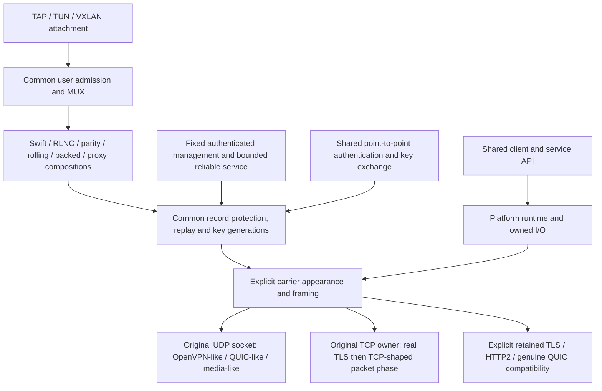

# Shared point-to-point secure session

Status: **planned architecture and acceptance contract**, reviewed with the owner
on 2026-11-13 (Asia/Tokyo). No WireGuard-like adapter, new carrier composition,
credential migration or recovery default is implemented by this document.
The [architecture](../architecture.md), [master ledger](../implementation-checklist.md)
and [carrier contracts](../overlay-and-carriers.md) retain their wider requirements.

## Owner decisions and remaining design work

The following requirements were explicitly confirmed in the architecture discussion:

- The deployment is a fixed point-to-point tunnel between controlled endpoints.
  An account system, device roster and multi-device enrollment are outside this
  change. Existing member credentials are not silently replaced.
- One internal authentication and secure-session protocol is reused across the
  selected carriers, including TCP/HTTPS-like. Swift is a data algorithm, not an
  independent connection mode or an implicit carrier selection.
- Use a lightweight **WireGuard-like authentication and session-lifecycle direction**
  in place of the separate TCP/TLS bootstrap dependency of the current Swift path.
  Preserve Swift's authenticated encryption. The intended change is the preceding
  authentication/key-exchange and carrier integration, not removal of data security.
- Authentication, data, management, liveness and rekeying use the selected carrier.
  Handshake-to-data transition retains its original connection or UDP socket and
  five-tuple. HTTPS-like additionally retains ports and coherent TCP sequence space.
- QUIC-like requires header appearance, not genuine QUIC data ACK/congestion
  semantics or complete standard-dissector validation. Add the simplest audio/video
  media appearance as another selectable outer profile; full WebRTC is not required.
- Bounded automatic recovery is the target default. A temporary interruption may
  retain the logical session, bounded unconfirmed data and control transactions.
  Rekeying alone does not reset a record-profile epoch. Peer restart or lost state
  requires authentication and explicit reconciliation or a new session.
- SW-11 still means negotiated switching between Swift and other record profiles.
  RLNC, parity, rolling, packed, proxy and all 47 Python parity gates remain required.

These decisions do **not** choose a Rust dependency, crypto suite, packet layout,
key-export API, credential conversion, timeout value or NAT-rebinding policy.
DTLS 1.3 was considered before the owner preferred the lighter WireGuard-like
direction; it is not the selected implementation. BoringTun and Noise libraries
are evaluation inputs, not adopted dependencies. Initial carrier names and any
new API names here are design labels, not accepted CLI syntax.

The original OpenVPN-like wire-format handshake requirement has not been explicitly
relaxed as QUIC-like was. Its composition with the shared internal protocol remains
an open design gate. Likewise, genuine TCP/TLS followed by a custom TCP-shaped
packet phase remains the requested HTTPS-like path; continuous HTTP/2 streaming
is a separate compatibility profile, not its replacement.

## Current source and evidence

| Component | Current evidence | Limit relative to this target |
| --- | --- | --- |
| TLS/member authentication | `l2tunnel-auth` implements verified TLS 1.3, exporter-bound Ed25519 membership and focused loopback tests. | Its generic channel interface still requires an actually verified TLS channel; it is not a standalone message-oriented key exchange. |
| Swift algorithm | `l2tunnel-swift` owns bounded packing, channel records, retransmission and optional repairs, with caller-supplied time and authenticated bodies. | Preserve this pure boundary while extracting shared security and control. |
| Swift security/runtime | `client-core/src/swift.rs` exports TLS data roots; `runtime/src/swift.rs` owns ChaCha20-Poly1305, a 4096-packet replay window and an HKDF chain every 2^28 packets. | Separate TCP/TLS control plus UDP data remains; the chain is not a fresh authenticated key exchange. |
| Swift control | `l2tunnel-swift/src/control.rs` defines private policy proposal/barrier messages on retained TLS. | SW-13 is within-Swift policy change, not the stable shared control service or SW-11. |
| Shared control | `l2tunnel-management` has pure framing, admission and transaction contracts; compression switching has scoped runtime evidence. | A universal negotiated control envelope and dispatch across data modes remain open under FIX-11. |
| UDP admission | `l2tunnel-udp-control` has bounded cookies, retries, replay checks and reliable control bytes, used by standalone OpenVPN-like TLS. | These mechanisms do not establish a WireGuard-like authenticated session or remove the stream dependency. |
| Platform/runtime | Finite Linux native receipts exist for named compositions. Windows is a CLI scaffold; Android is a staging library without JNI/VpnService. | No new common-session platform support follows from this design. |

Source entry points: [Swift factory](../../crates/l2tunnel-client-core/src/swift.rs),
[Swift runtime](../../crates/l2tunnel-runtime/src/swift.rs),
[pure engine](../../crates/l2tunnel-swift/src/lib.rs),
[auth adapter](../../crates/l2tunnel-auth/src/lib.rs),
[common control](../../crates/l2tunnel-management/src/session_control.rs) and
[UDP admission](../../crates/l2tunnel-udp-control/src/lib.rs).
Historical measurements and failed runs remain in their original receipts; none
qualifies a new security/carrier composition.

## Protocol and runtime boundaries



Public protocol APIs accept bounded packets, injected monotonic time, supplied
randomness where required, authenticated events and configuration; they emit
bounded actions. They own no Tokio task, OS descriptor, real clock, device or
privilege. Platform runtimes own those resources. Any FFI exception must remain
narrowly documented outside the pure libraries; library-wide unsafe defaults stay
forbidden. An existing library with internal clocks needs an appropriate public
interface or reviewed adaptation, not a claim of time injection through a test flag.

Handshake, secure record, management and data-recovery state are separate.
The shared session accepts opaque bounded records rather than only IP packets:
Ethernet frames, packed sources, repairs, feedback and internal controls must all
be representable without fabricated IP wrappers. Carrier capability negotiation
rejects unsupported combinations before user I/O. Existing ordinary TCP still has
kernel ACK/window/retransmission and outer head-of-line behavior; common inner
records do not remove it.

## Authentication and cryptographic contract

Reuse maintained authenticated key-exchange and crypto implementations. The
WireGuard direction includes handshake retry, admission cookies, replay handling,
key overlap, keepalive, expiry and fresh handshakes; bare Noise alone supplies
neither all of those policies nor a reliable management protocol.

Before data release, confirm peer identity, roles, fresh session identity, protocol
version, complete capability selection, carrier/appearance, protection mode,
resource limits, packet layer and configuration digest. Define a supported binding
between the outer handshake/ownership transition and the inner authenticated
session. A copied packet from a different carrier, role, session, lane or epoch
must not authorize progress. Disable replayable early user/configuration data.

Preserve the AEAD behavior of the Swift path. Use separate secret domains for
data, management, joining, direction, physical lane and key generation, with unique
packet numbers and authenticated metadata. Only authenticated valid input commits
replay state. Key updates and full fresh key exchange are distinct operations;
neither may reset counters under an old key or reset a data-mode epoch.

The earlier AEAD-or-authenticated-cleartext/MAC requirement for generic UDP/raw
profiles remains tracked. The latest owner clarification retains Swift's
encryption; it is not an instruction to remove other requested profile behavior.
Standard WireGuard always encrypts transport data. Supporting a MAC-only profile
therefore needs an explicitly negotiated extension and reviewed key/protection
contract, not a claim of unmodified WireGuard compatibility.

Do not use a public handshake hash/channel binding as a secret MAC key. Do not
extract private cipher state, convert Ed25519 key bytes into X25519 keys, or expose
secret roots in logs/config/status. A suitable implementation must provide a
supported protection/key interface or a reviewed maintained extension. No library
has passed that gate here.

## Fixed control and bounded recovery

Control framing and service remain readable while data MUX, codec or recovery
changes. Management has a bounded reservation within the configured wire budget;
all user traffic, including probes and TCP control packets, still shares the
ordinary MUX admission and channel pool. User Ethernet/VXLAN bytes never grant
control authority. Reliable management means authenticated request IDs, duplicate
idempotence, retries, absolute deadlines, epoch/digest checks and drain barriers;
packet encryption alone does not supply command completion.

Recovery must distinguish transient path loss, expired security material, process
restart and irrecoverable configuration/ownership errors. Retry without extending
the accepted operation's absolute deadline. Bound retained bytes, records,
handshake attempts, crypto work and pending controls; backpressure ingress when
those bounds are reached. Every waiting handshake/proposal/barrier/commit phase
needs a deadline and an explicit terminal/reconciliation result. A duplicate or
replayed packet must not manufacture liveness or reset an expiry timer.

During a recoverable interruption, keep the existing logical identity, eligible
unconfirmed records, native-delivery debt and mode transaction state within the
agreed bounds. New security keys do not by themselves authorize forgetting those
obligations. A peer that lost the state must establish fresh authenticated evidence
before reconciling; uncertain commits never permit unilateral rollback or blind
replay into a new session. Finite buffering cannot promise survival of every inner
TCP connection or recovery from an arbitrarily long outage.

Ordinary recovery retains the selected carrier and its original flow. NAT
rebinding, endpoint changes and path migration require a separately specified
authenticated policy; they are not implied by automatic recovery. The HTTPS raw
phase has its own irreversible ownership boundary: recovery must not restart TLS
on a tuple whose TLS state was retired. Authorized fallback is explicit and visible.
Numeric timeouts and retention limits remain unset pending design and measurement.

## Acceptance tasks

All items below are **planned**. Writing this contract does not check a task.

- [ ] [SEC-01] Freeze the common point-to-point authentication, opaque-record and fixed-control interfaces, canonical binding transcript and resource model; document current versus target behavior and preserve all existing mode requirements.
- [ ] [SEC-02] Select and pin a maintained WireGuard-like/Noise-based implementation with reviewed cryptographic and public protection/key APIs; establish injected time/randomness, bounded errors, safety/dependency policy and exact adaptation scope without private-state extraction.
- [ ] [SEC-03] Specify trust and credential provisioning/binding for the two endpoints, existing member identity, revocation and outer certificate/SNI policy; test wrong peer, role, carrier, configuration and downgrade rejection before data release.
- [ ] [SEC-04] Implement bounded handshake retransmission, cookie/return-path admission, anti-amplification, duplicate idempotence and original deadlines; fault-test every flight including final confirmation, replayed initiations and peer restart.
- [ ] [SEC-05] Share packet AEAD, authenticated metadata, purpose/direction/lane key separation, nonwrapping counters and replay windows; qualify compact overhead and preserve the separately required authenticated-cleartext contract without inventing cryptographic primitives.
- [ ] [SEC-06] Implement authenticated key update, fresh key exchange, overlapping receive generations, usage/time expiry and secret retirement under loss/reorder; prove that profile switching or retries cannot reuse nonces or reset the data epoch.
- [ ] [SEC-07] Carry stable authenticated management, liveness and recovery feedback through the selected carrier with bounded reliable service, typed feedback, retry/deadline/duplicate rules and shared byte accounting; qualify control progress under saturated user traffic.
- [ ] [SEC-08] Implement default bounded automatic recovery with retained logical/data/control state, explicit peer-restart reconciliation or new session, no uncertain-commit rollback, bounded ingress pressure and observable terminal reasons.
- [ ] [SEC-09] Compose authentication, protection and control on the original selected connection/socket/five-tuple; remove the mandatory separate TCP-control/UDP-data split from the target and qualify HTTPS TLS-to-packet ownership and failure cleanup independently.
- [ ] [SEC-10] Integrate Swift and every supported record/recovery composition through the shared session and service API; preserve full SW-11, original deadlines, arbitrary real bytes, all 47 P-* gates and explicit unsupported-combination reporting.
- [ ] [SEC-11] Qualify deterministic parser/security/state failures plus actual two-runtime loss/reorder/duplicate/outage/rekey/switch tests; record exact source/configuration hashes and separate protocol tests, loopback integration, Linux namespace labs, CI and Windows/Android execution.
- [ ] [SEC-12] Run controlled carrier-appearance and real-path QoS comparisons with captures and negative outcomes; separate header parsing, full protocol validity, endpoint interoperability, identification and measured path treatment, with simulator results kept distinct.

These gates refine FIX-10/FIX-11/FIX-12 and CONN-*/DATA-* rather than replacing
them. Carrier, client and Swift child tasks remain in their own ledgers.

## Primary references and evaluation limits

- [WireGuard protocol](https://www.wireguard.com/protocol/) describes its complete
  key exchange, cookies, replay and lifecycle; it is more than two Noise messages.
- [BoringTun core](https://github.com/cloudflare/boringtun/tree/master/boringtun/src/noise)
  is an implementation candidate/reference. Its current public tunnel interface
  expects IP payloads, uses internal clocks and exposes no general secret exporter
  identified in this review; it is not an adopted opaque-record/session adapter.
- [Noise framework](https://noiseprotocol.org/noise.html) leaves lossy handshake,
  replay-window and lifecycle integration responsibilities to the application.
- [DTLS 1.3](https://www.rfc-editor.org/rfc/rfc9147.html) was an earlier candidate;
  accepting its evaluation did not select it or change confidentiality semantics.

These are source/documentation review inputs, not dependency approval, an
independent security audit, a platform receipt or a performance result.

## Documentation review validation

On 2026-11-13 (Asia/Tokyo), this documentation update ran:

```sh
PATH=/tmp/l2tunnel-quic-venv/bin:$PATH PYTHONDONTWRITEBYTECODE=1 python3 tools/check.py
PYTHONDONTWRITEBYTECODE=1 python3 tools/check_checklists.py
git diff --check
```

The required full check passed dependency, catalog/checklist, source-identity,
golden-vector and formatting stages, then failed strict Clippy at
`crates/l2tunnel-runtime/src/swift.rs:1951` (`manual_is_multiple_of`) in the
pre-existing runtime test code. It stopped before workspace Rust tests, rustdoc,
CLI/lab checks and the full simulator suite; none of those later stages is claimed
as executed by this update. The separate final checklist check passed 1,134 unique
tasks, 678 existing checked deliverables and 47 parity gates. No task was checked
or unchecked by this review. Whitespace and relative file-link checks passed.
Tracked non-documentation inputs and the pre-existing untracked Swift control
source were verified unchanged. Historical receipts and simulator results were
not replaced. This is a documentation review result, not SEC-* implementation
or qualification evidence.
